<div dir="rtl">

<p align="center"></p>

<h1 align="center">Laravel Dev</h1>

<p align="center">
  <b>بيئة تطوير محلية لمشاريع Laravel على Linux، على طريقة Laravel Herd.</b><br>
  <a href="README.md">English</a> · <b>العربية</b>
</p>

<p align="center">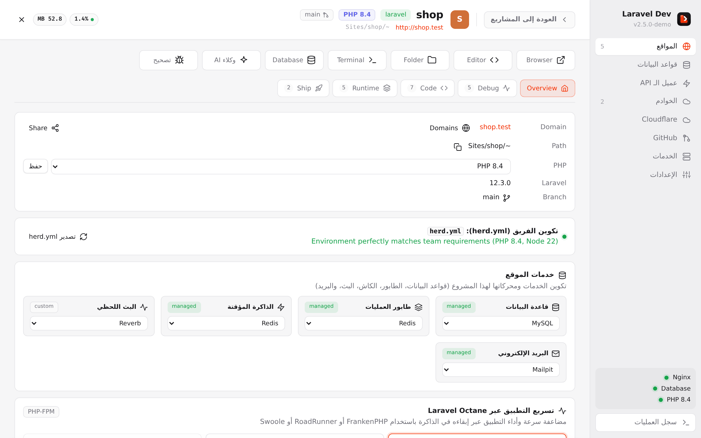</p>

Laravel Dev تطبيق سطح مكتب يشغّل مشاريعك على جهازك. كل مشروع يأخذ عنوان `.test` خاصاً به، مثل `http://shop.test`، ويعمل عبر nginx وPHP-FPM. ومعه أدوات العمل اليومي: السجلات، ومراقبة الطلبات واستعلامات SQL، ومدير قواعد البيانات، والطوابير، والبريد، والاختبارات، والنسخ الاحتياطي، وGitHub، وCloudflare، والنشر على خوادمك.

| النظام | الدعم |
|---|---|
| **Linux** | كامل: nginx ونطاقات `.test` وPHP-FPM والخدمات وHTTPS |
| **macOS وWindows** | وضع محمول: لا يتغير شيء في نظامك، وكل مشروع يعمل على منفذ `localhost` |

ويشغّل أيضاً **Next.js وNuxt وVite وNode وDjango**، وWordPress وSymfony ومشاريع PHP أخرى.

## المحتويات

- **البداية:** [المتطلبات](#المتطلبات) · [التثبيت](#التثبيت) · [أول 5 دقائق](#أول-5-دقائق) · [إضافة المشاريع](#إضافة-المشاريع)
- **الاستخدام:** [النافذة](#النافذة) · [لوحة الموقع](#لوحة-الموقع) · [مراقبة الطلبات](#مراقبة-الطلبات-والاستعلامات) · [Xdebug](#تصحيح-الأخطاء-بـ-xdebug) · [قواعد البيانات](#قواعد-البيانات) · [عميل API](#عميل-api) · [GitHub](#github) · [Cloudflare والمشاركة](#cloudflare-والمشاركة) · [الخوادم](#الخوادم) · [الخدمات وPHP](#الخدمات-ونسخ-php) · [الذكاء الاصطناعي](#أدوات-الذكاء-الاصطناعي)
- **المرجع:** [الاختصارات](#الاختصارات) · [سطر الأوامر](#سطر-الأوامر) · [ملف الفريق](#ملف-الفريق) · [أماكن الملفات](#أماكن-الملفات) · [التحديث والإزالة](#التحديث-والإزالة) · [حل المشاكل](#حل-المشاكل)

---

## المتطلبات

**Linux:** توزيعة تستخدم `apt` أو `pacman` أو `dnf`/`yum` أو `zypper` (مثل Ubuntu وDebian وKali وArch وFedora وopenSUSE)، ومستخدم يملك صلاحية `sudo`، واتصال بالإنترنت أثناء التثبيت، وسطح مكتب.

المثبّت ينزّل الباقي وحده: nginx، وMariaDB (أو MySQL)، وPHP مع PHP-FPM، وComposer، ومكتبات النافذة (Python 3 وGTK وWebKitGTK)، وGit.

إضافات اختيارية يحاول المثبّت تنزيلها:

| الحزمة | الفائدة |
|---|---|
| `mkcert` | شهادة HTTPS محلية موثوقة |
| `cloudflared` | روابط عامة للمشاركة |
| `nodejs` و`npm` | مشاريع Next.js وNuxt وVite وNode |
| `python3-venv` | مشاريع Django |
| AppIndicator | أيقونة شريط النظام |

**macOS وWindows:** نسخة Python 3.10 أو أحدث (يعرض المثبّت تنزيلها)، والأدوات التي تحتاجها مشاريعك (PHP وComposer وNode وGit) متاحة في `PATH`.

---

## التثبيت

نزّل ملف نظامك من صفحة **Releases** في المشروع:

| النظام | الملف |
|---|---|
| Linux | `laravel-dev-installer.sh` |
| macOS | `laravel-dev-installer-macos.command` |
| Windows | `laravel-dev-installer-windows.cmd` |

كل ملف يحتوي التطبيق كاملاً، ويتحقق من سلامته (SHA-256) قبل التثبيت. **للتحديث شغّل نفس الملف من إصدار أحدث.**

### Linux

افتح الطرفية في مجلد التنزيل:

</div>

```bash
chmod +x laravel-dev-installer.sh
./laravel-dev-installer.sh
```

<div dir="rtl">

لا تشغّله بـ `sudo`؛ سيطلب كلمة المرور عند الحاجة. وسيقوم بالتالي:

1. تثبيت المتطلبات حسب توزيعتك.
2. تثبيت التطبيق في `/opt/laravel-dev`.
3. إضافة الأمر `laravel-dev`.
4. إضافة **Laravel Dev** إلى قائمة التطبيقات.
5. تشغيل nginx وقاعدة البيانات وPHP-FPM.

**نسخ PHP إضافية:** ثبّتها من توزيعتك أو من مستودع مثل `ppa:ondrej/php` في Ubuntu، أو من صفحة **الخدمات** في التطبيق. التطبيق يكتشف كل نسخة، وتختار نسخة لكل مشروع.

### macOS

</div>

```bash
bash laravel-dev-installer-macos.command
```

<div dir="rtl">

يُثبَّت في `~/Applications` دون `sudo`.

### Windows

انقر نقراً مزدوجاً على `laravel-dev-installer-windows.cmd`. إن ظهرت رسالة "Windows protected your PC" فاضغط **More info ثم Run anyway**. يُثبَّت لمستخدمك فقط دون صلاحيات المدير.

---

## أول 5 دقائق

1. **افتح التطبيق** من قائمة التطبيقات، أو بالأمر `laravel-dev app`.
2. **تأكد من الخدمات:** أسفل القائمة الجانبية تظهر حالة nginx وقاعدة البيانات وPHP. إن لم تكن النقطة خضراء فافتح **الخدمات** واضغط **تشغيل الكل**.
3. **اختر مجلد المشاريع** من **الإعدادات** (مثل `~/Sites`). المشاريع الموجودة فيه تظهر وحدها.
4. **أضف مشروعاً:** اضغط `Ctrl+N`، واكتب الاسم، ثم أنشئه.
5. **افتحه:** عند انتهاء المهمة يعمل `http://<الاسم>.test` في المتصفح.

للعربية: **الإعدادات ← اللغة ← العربية**، فتصبح الواجهة من اليمين إلى اليسار.

> الإجراءات التي تحتاج صلاحيات النظام، مثل كتابة ملف nginx، تطلب كلمة مرورك في نافذة صغيرة.

---

## إضافة المشاريع

<p align="center">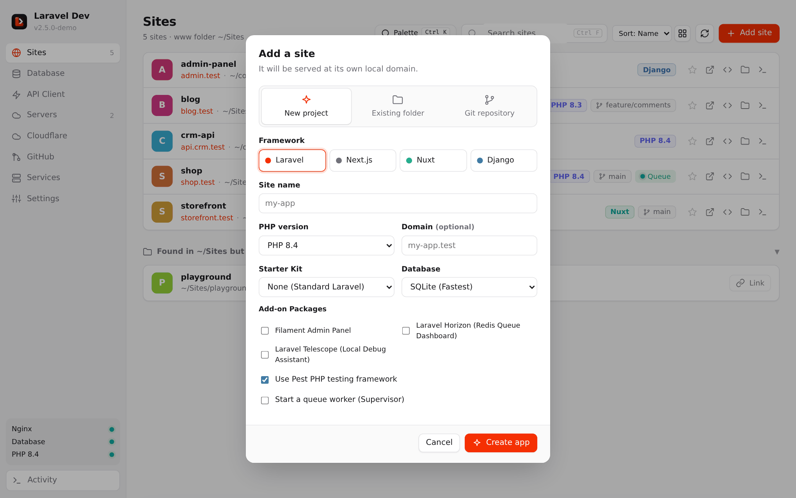</p>

اضغط **إضافة موقع** (`Ctrl+N`). أمامك ثلاث طرق:

**1. مشروع جديد:** اختر النوع (Laravel أو Next.js أو Nuxt أو Django) والاسم ونسخة PHP وقاعدة البيانات. يُنشأ المشروع وقاعدته وملف `.env` وموقع nginx.

**2. مجلد موجود:** اختر المجلد ويُكتشف نوعه. إن كان خارج مجلد المشاريع فاختر:

| الخيار | ما يحدث |
|---|---|
| **نقل** (الافتراضي) | يُنقل المجلد إلى مجلد المشاريع |
| **نسخ** | تُنسخ نسخة ويبقى الأصل |
| **اختصار** | رابط يشير إلى مكانه الأصلي |
| **إبقاؤه** | يعمل من مكانه |

**3. مستودع Git:** الصق الرابط (ورمز الوصول إن كان خاصاً). يُستنسخ وتُثبَّت حزم Composer ويُنشأ `.env` وقاعدة البيانات.

مشاريع Next.js وNuxt وVite وNode وDjango تعمل بخادمها الخاص: اضغط ▶ لتشغيلها.

---

## النافذة

<p align="center">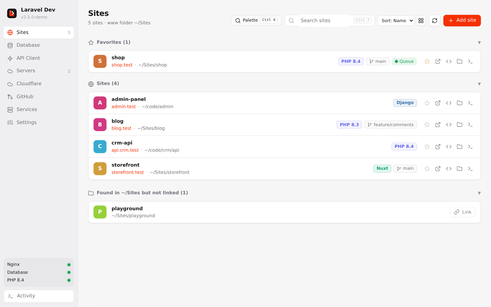</p>

| الصفحة | الغرض |
|---|---|
| **المواقع** | كل مشاريعك وحالتها وأدواتها |
| **قواعد البيانات** | مدير قواعد بيانات كل المشاريع |
| **عميل API** | إرسال الطلبات وحفظها، مثل Postman |
| **الخوادم** | خوادمك عبر SSH |
| **Cloudflare** | النطاقات وDNS والكاش وWorkers وR2 والأنفاق |
| **GitHub** | المستودعات والكود وPull Requests وIssues وActions |
| **الخدمات** | nginx وقاعدة البيانات وPHP-FPM وRedis وMailpit وغيرها |
| **الإعدادات** | مجلد المشاريع والمحرر والمظهر واللغة والاختصارات والخزينة |

- **سجل العمليات** (`` Ctrl+` ``) يعرض كل مهمة ومخرجاتها، وسبب الفشل إن فشلت.
- **لوحة الأوامر** (`Ctrl+K`) تبحث في المشاريع والصفحات وأوامر artisan.
- **المفضلة والعرض الشبكي:** النجمة تثبّت الموقع في الأعلى، وزر الشبكة يعرض البطاقات، والكاميرا على البطاقة تلتقط صورة للموقع.
- **أيقونة النظام:** إغلاق النافذة يُبقي التطبيق يعمل. يمكن إيقاف ذلك من الإعدادات.

<p align="center">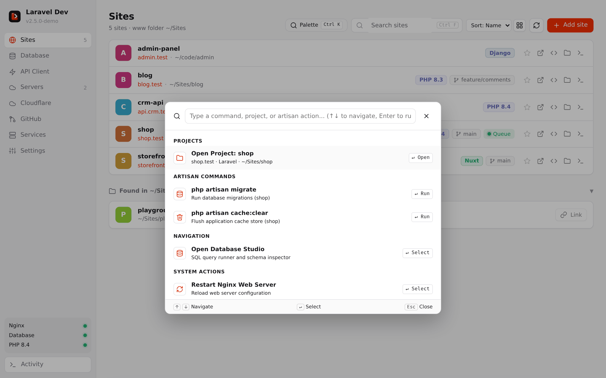</p>

---

## لوحة الموقع

انقر على أي موقع لفتح لوحته.

<p align="center">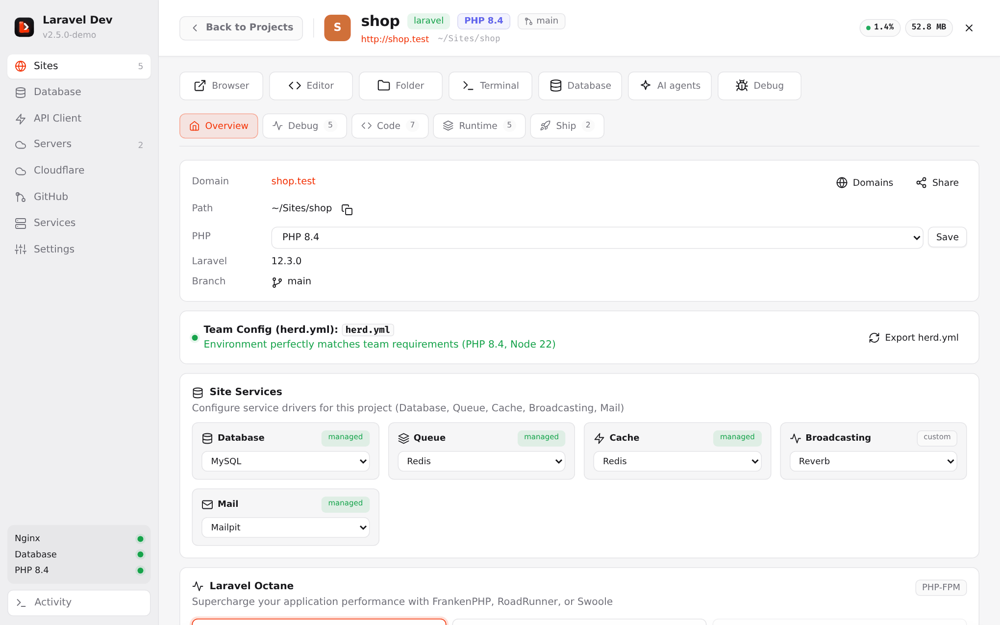</p>

### نظرة عامة (Overview)

- العنوان والمجلد والفرع و**نسخة PHP**: اختر نسخة أخرى واضغط **حفظ**.
- **خدمات الموقع:** بدّل قاعدة البيانات والطابور والكاش والبث والبريد، ويُحدَّث `.env` عنك.
- **النطاقات:** أضف نطاقات أخرى مثل `api.shop.test`.
- **المشاركة:** رابط لشبكة Wi-Fi مع رمز QR، أو رابط عام عبر Cloudflare.
- **HTTPS** بشهادة محلية موثوقة.
- **الطبيب (Doctor)** يفحص الصلاحيات و`.env` والمفتاح والترحيلات، ولكل مشكلة زر إصلاح. و**إصلاح (Repair)** يعيد بناء إعداد nginx والصلاحيات واتصال القاعدة.

### التصحيح (Debug)

| التبويب | الغرض |
|---|---|
| **Requests & Queries** | كل طلب واستعلاماته. انظر [مراقبة الطلبات](#مراقبة-الطلبات-والاستعلامات) |
| **Logs** | السجلات مرتبة بالمستوى، مع البحث وإخفاء المتشابه و**AI Fix** |
| **Dumps** | يلتقط `dump()` ويعرضه هنا بدل الصفحة |
| **Mail** | البريد الذي يرسله المشروع، مع المعاينة |
| **Tests** | تشغيل Pest أو PHPUnit، والفشل يُفتح على السطر في المحرر |

<p align="center">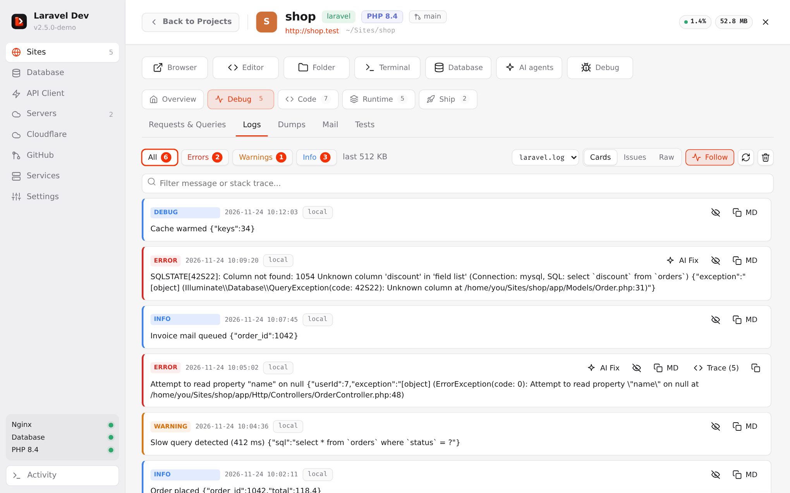</p>

### الكود (Code)

| التبويب | الغرض |
|---|---|
| **Studio Agent** | محادثة مع وكيل برمجة حول المشروع، ويستأذن قبل التعديل |
| **Models** | نماذج Eloquent وأعمدتها وعلاقاتها |
| **Routes** | كل المسارات مع البحث وفتح المتحكم |
| **API Client** | مسارات المشروع كطلبات جاهزة |
| **Tinker** | تشغيل PHP داخل المشروع |
| **Translations** | ملفات الترجمة جنباً إلى جنب |
| **Packages** | حزم Composer وnpm القديمة والتنبيهات الأمنية |

### التشغيل (Runtime)

| التبويب | الغرض |
|---|---|
| **Environment** | تحرير `.env`: القيم السرية مخفية، ولا يُكتب شيء قبل **حفظ** |
| **Queues & Cron** | عمال الطوابير والمهام الفاشلة والمجدول |
| **Cache & Redis** | مفاتيح الكاش وقيمها وحذفها |
| **Vite & Assets** | خادم الواجهة ومخرجاته |
| **Storage Gallery** | ملفات `storage/app/public` |

<p align="center">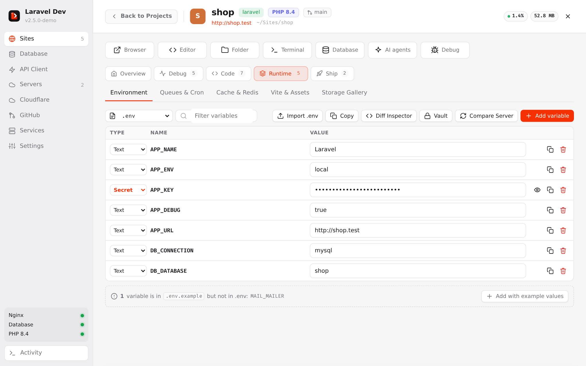</p>

**تشغيل Vite تلقائياً:** في **Vite & Assets** فعّل **شغّله عند فتح الموقع**. بعدها، فتح الموقع من التطبيق يشغّل خادم الواجهة أولاً وينتظر جاهزيته. ويتوقف بعد 15 دقيقة دون صفحة مفتوحة، أو عند إغلاق التطبيق.

<p align="center">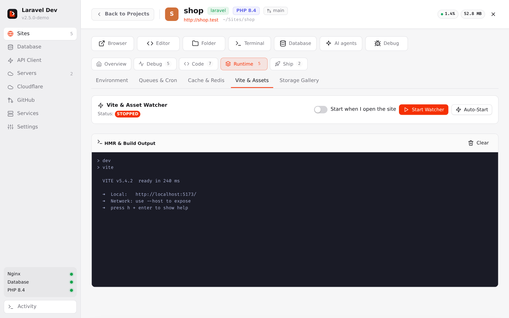</p>

### النشر (Ship)

| التبويب | الغرض |
|---|---|
| **Git** | التغييرات والفروع والحفظ والدفع والسحب |
| **Time Machine** | نقطة تحفظ `.env` وقاعدة البيانات والملفات معاً، و**استعادة** ترجعها (وتحفظ الحالة الحالية أولاً) |
| **Deploy** | النشر على أحد خوادمك، والنسخ الاحتياطي |

<p align="center">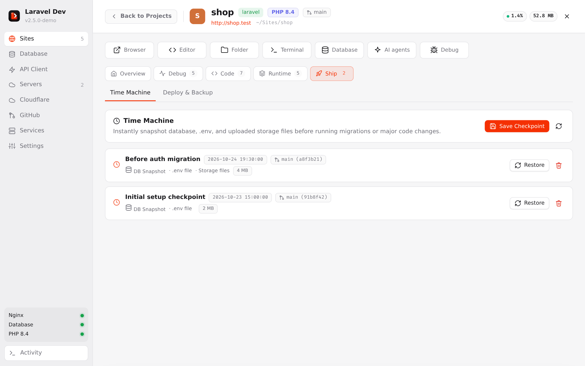</p>

---

## مراقبة الطلبات والاستعلامات

<p align="center">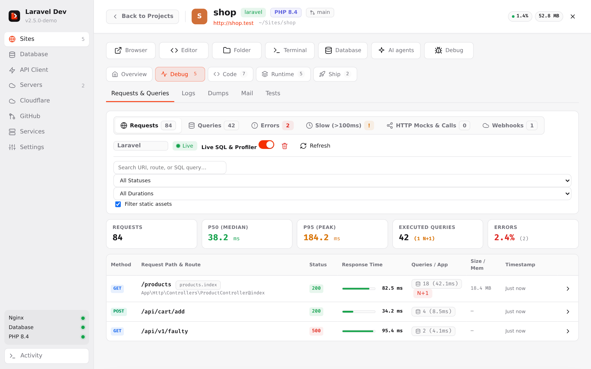</p>

1. افتح الموقع، ثم **Debug ← Requests & Queries**.
2. فعّل **Live SQL & Profiler**. تُضاف حزمة تطوير صغيرة إلى المشروع عبر Composer (10 إلى 30 ثانية).
3. تصفّح موقعك فتظهر الطلبات هنا.

> هذا يعدّل `composer.json` و`composer.lock`. أوقف المراقبة قبل أن تحفظ في Git، فيعود الملفان كما كانا.

انقر على طلب لترى الترويسات والبيانات والرد والتوقيت والاستعلامات وأمر cURL. وعلامة **N+1** تدل على استعلام متكرر: انقر عليه لترى السطر الذي يستدعيه وخطة `EXPLAIN`.

<p align="center">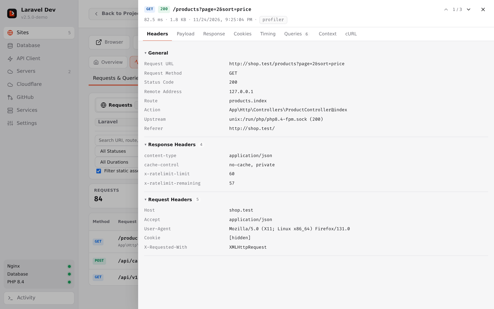</p>

---

## تصحيح الأخطاء بـ Xdebug

تحميل Xdebug يبطئ كل الطلبات. **Xdebug عند الطلب** يُبقي PHP العادي سريعاً، ويشغّل PHP-FPM ثانياً فيه Xdebug، ولا تذهب إليه إلا الطلبات التي تطلب التصحيح.

1. ثبّت Xdebug إن لزم: `laravel-dev php-ext 8.4 install xdebug`.
2. في **الخدمات** اضغط **Xdebug عند الطلب** بجانب نسخة PHP حتى يصبح أخضر.
3. من زر **تصحيح** في الموقع أضف `launch.json`، ثم ابدأ الاستماع في VS Code (F5). المنفذ 9003.
4. اضغط *Debug* في إضافة المتصفح **Xdebug Helper** وأعد تحميل الصفحة، أو أضف `?XDEBUG_SESSION_START=1` إلى الرابط.

على Debian وUbuntu وKali يُزال Xdebug من PHP-FPM العادي فقط ويبقى في سطر الأوامر، والإيقاف يعيد ما كان.

<p align="center">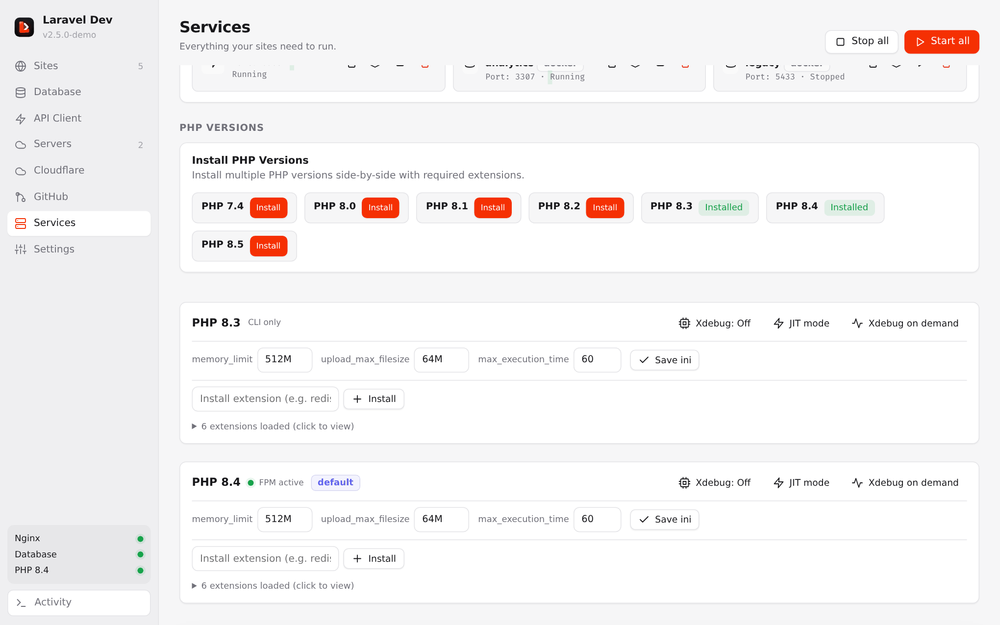</p>

---

## قواعد البيانات

<p align="center">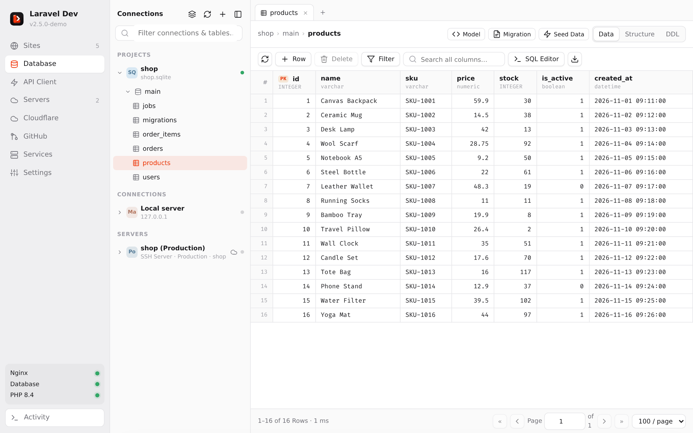</p>

- يدعم MySQL وMariaDB وPostgreSQL وSQLite.
- الاتصالات تأتي من خادمك المحلي، ومن `.env` كل مشروع، ومما تضيفه أنت، ومن خوادمك عبر SSH.
- انقر مرتين على خلية لتعديلها، ثم **حفظ** (`Ctrl+S`). التعديلات كلها في عملية واحدة.
- اكتب SQL وشغّله بـ `Ctrl+Enter`، وصدّر SQL وCSV وJSON، واستورد ملفات `.sql`.

---

## عميل API

<p align="center">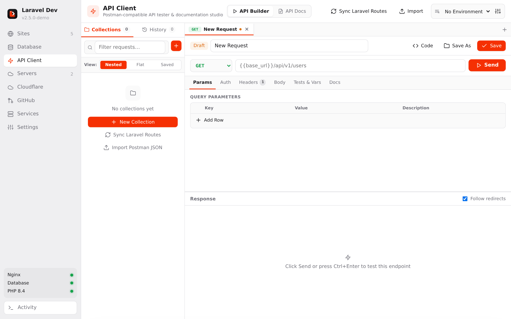</p>

- مجموعات ومجلدات وبيئات بمتغيرات `{{name}}`.
- **Sync Laravel Routes** يحوّل مسارات المشروع إلى طلبات جاهزة.
- Bearer وBasic وAPI key وLaravel Sanctum، وJSON وملفات وGraphQL، واختبارات على الرد.
- استيراد Postman وOpenAPI وcURL، وتصدير توثيق HTML وMarkdown وOpenAPI.

---

## GitHub

اربط حسابك برمز **Personal Access Token**. الصلاحيات المقترحة: `repo` و`workflow` و`read:org`. ويمكن ربط أكثر من حساب.

<p align="center">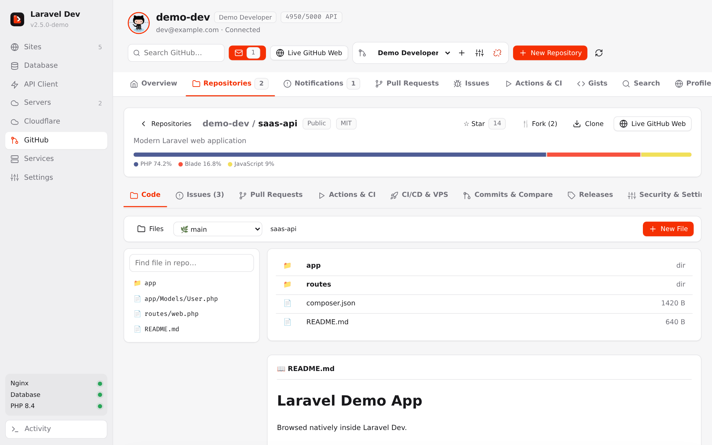</p>

- **المستودعات:** تصفح الكود وتعديله وحفظه، ومقارنة الفروع والإصدارات.
- **Pull Requests وIssues:** القراءة والتعليق والمراجعة والدمج والإغلاق.
- **Actions:** التشغيلات وسجلاتها وإعادتها. و**CI/CD & VPS** ينشئ ملف نشر إلى خادمك.
- **المواقع المحلية:** انشر مشروعاً في مستودع جديد، أو اربطه بمستودع موجود.

الرمز محفوظ في `~/.config/laravel-dev/github.json` ولا يقرؤه غيرك. فعّل **الخزينة** من الإعدادات لتشفيره.

---

## Cloudflare والمشاركة

<p align="center">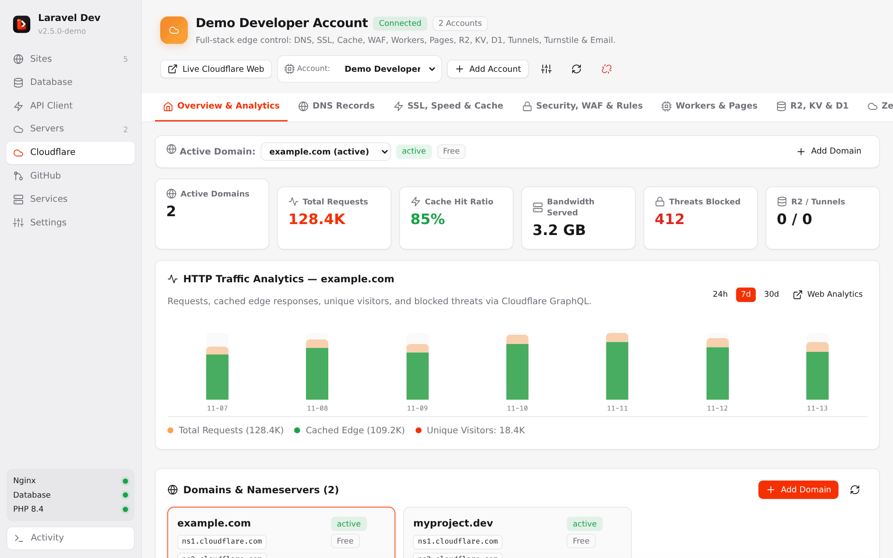</p>

اربط حسابك برمز API لإدارة DNS وSSL والكاش والجدار الناري وWorkers وR2 والأنفاق.

لمشاركة موقع محلي:

</div>

```bash
laravel-dev share shop                         # رابط عام مؤقت
laravel-dev share shop --auth user:secret      # مع كلمة مرور
laravel-dev expose shop lan                    # من شبكة Wi-Fi
```

<div dir="rtl">

---

## الخوادم

<p align="center">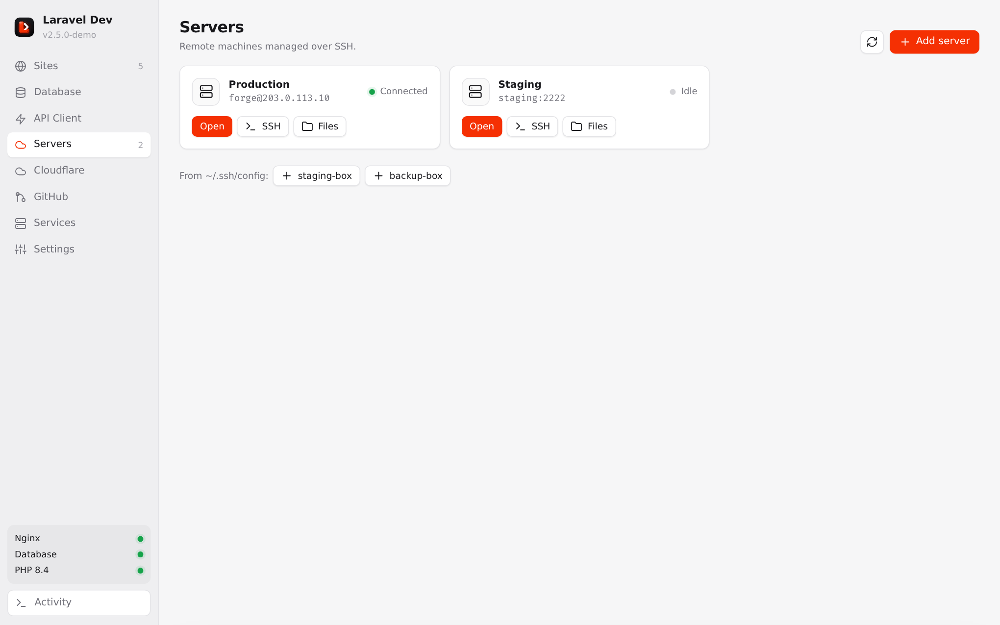</p>

**الخوادم ← إضافة خادم**، أو اختر من `~/.ssh/config`. لا يُثبَّت شيء على الخادم.

- **نظرة عامة:** المعالج والذاكرة والقرص، وتشغيل الخدمات وإيقافها.
- **المواقع:** زر **نشر** يناسب النوع (Laravel أو Next.js أو Nuxt أو Django)، وأوامر artisan والسجلات.
- **الملفات:** تصفح ورفع وتنزيل، وفتح الملف في محررك مع رفع كل حفظ.
- **طرفية SSH** متصلة مباشرة.

<p align="center">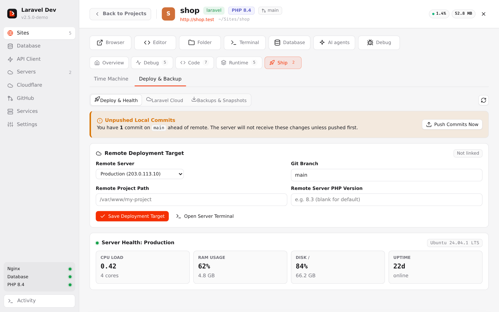</p>

---

## الخدمات ونسخ PHP

<p align="center">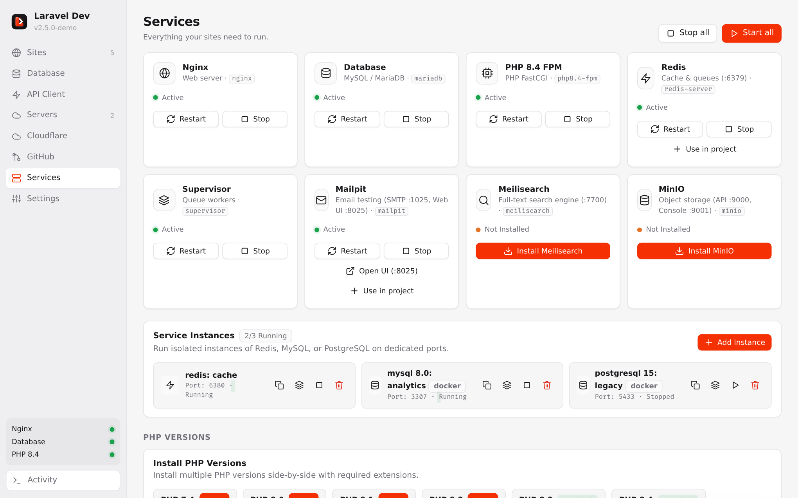</p>

تشغيل وإيقاف nginx وقاعدة البيانات وPHP-FPM وRedis وSupervisor، وتثبيت **Mailpit** (بريد محلي) و**Redis** و**Meilisearch** و**MinIO** بنقرة. وزر **استخدام في مشروع** يكتب الإعدادات في `.env`.

ولكل نسخة PHP: تشغيل Xdebug، وتعديل `php.ini`، وتثبيت الإضافات.

### عدة نسخ من نفس الخدمة

**إضافة نسخة (Add Instance)** تشغّل MySQL أو MariaDB أو PostgreSQL أو Redis آخر على منفذ خاص وببيانات خاصة. اختر نسخة مثل MySQL 8.0. إن لم تكن مثبتة فستعمل داخل حاوية **Docker أو Podman**، باسم مستخدمك، ولا تُفتح إلا على جهازك.

<p align="center">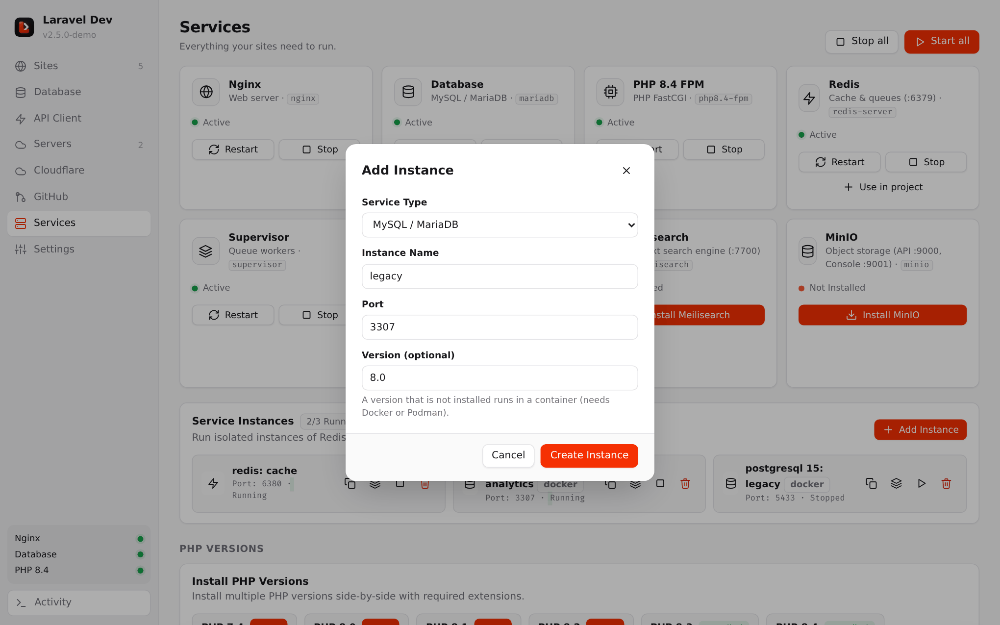</p>

</div>

```bash
laravel-dev instance create mysql legacy 3307 8.0
laravel-dev instance create postgresql old 5433 15
laravel-dev instance clone postgresql old copy 5434    # مع البيانات
laravel-dev instance list
laravel-dev instance delete mysql legacy               # يحذف بياناتها أيضاً
```

<div dir="rtl">

النسختان 10 و11 من `mysql` هما MariaDB. لا كلمة مرور لهذه النسخ المحلية (`root` في MySQL و`postgres` في PostgreSQL).

---

## أدوات الذكاء الاصطناعي

<p align="center">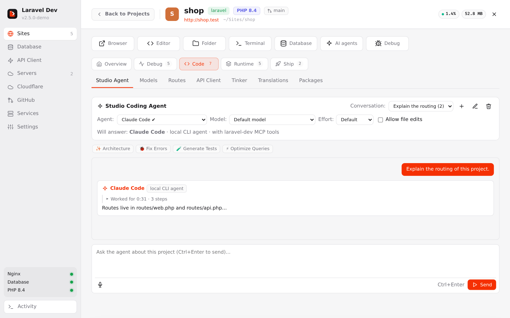</p>

- **AI Fix** في السجلات والطبيب يشرح الخطأ ويقترح تعديلاً، وأنت تقرر تطبيقه. اختر المزود من **الإعدادات ← AI Assistant** (Ollama محلي، أو Anthropic وOpenAI وGemini وغيرها). مع المزودات السحابية يُرسَل إليها الخطأ والكود المتعلق به.
- **Studio Agent** يشغّل وكيل برمجة مثبتاً على جهازك.
- **خادم MCP** يتيح لـ Claude Code وCursor وغيرهما قراءة مشاريعك ومساراتها وسجلاتها:

</div>

```bash
claude mcp add --scope user laravel-dev -- laravel-dev mcp
```

<div dir="rtl">

الأدوات التي تحتاج صلاحيات النظام لا تُظهر نافذة كلمة مرور، وتعمل فقط إن كانت لديك جلسة صلاحيات مفتوحة.

---

## الاختصارات

| المفاتيح | الإجراء |
|---|---|
| `Ctrl+K` | لوحة الأوامر |
| `Ctrl+N` | إضافة موقع |
| `Ctrl+F` | البحث في المواقع |
| `Ctrl+R` | تحديث |
| `` Ctrl+` `` | سجل العمليات |
| `Ctrl+1` … `Ctrl+8` | صفحات التطبيق بالترتيب |
| `Esc` | إغلاق |

**من أي تطبيق:** **الإعدادات ← اختصارات على مستوى النظام ← إضافة الاختصارات** (GNOME وXfce)، أو `laravel-dev shortcuts install`:

| المفاتيح | يفتح |
|---|---|
| `Super+Alt+D` | Laravel Dev |
| `Super+Alt+T` | Tinker |
| `Super+Alt+G` | السجلات |
| `Super+Alt+M` | البريد |
| `Super+Alt+B` | قواعد البيانات |
| `Super+Alt+N` | موقع جديد |

المفتاح المستخدم مسبقاً لا يُغيَّر، و**إزالة** تحذف هذه فقط.

<p align="center">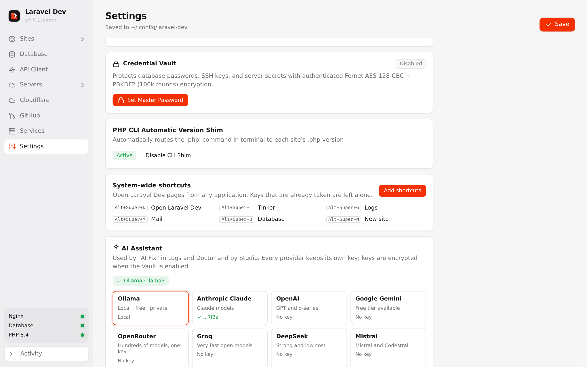</p>

---

## سطر الأوامر

</div>

```bash
# المشاريع
laravel-dev create shop 8.4                    # مشروع جديد
laravel-dev link shop ~/code/shop 8.3          # مجلد موجود
laravel-dev git-clone shop https://github.com/me/shop.git 8.4
laravel-dev list
laravel-dev doctor shop                        # فحص
laravel-dev repair shop                        # إصلاح
laravel-dev unlink shop                        # إيقاف الموقع وإبقاء الملفات
laravel-dev delete shop                        # حذف المشروع

# HTTPS وPHP والخدمات
laravel-dev secure shop
laravel-dev isolate shop 8.3                   # نسخة PHP للموقع
laravel-dev start
laravel-dev service restart nginx
laravel-dev service-install redis
laravel-dev php-debug-pool 8.4 enable          # Xdebug عند الطلب

# الطوابير والمجدول والنسخ الاحتياطي
laravel-dev worker-setup shop
laravel-dev cron enable shop
laravel-dev backup-run shop full

# التطبيق
laravel-dev app --page=logs --site=shop
laravel-dev                                    # كل الأوامر
```

<div dir="rtl">

---

## ملف الفريق

ضع `laravel-dev.yml` في المشروع ليحصل الجميع على نفس البيئة:

</div>

```yaml
php: "8.4"
node: "22"
services:
  mysql: true
  redis: true
```

```bash
laravel-dev init            # إنشاء الملف من .env
laravel-dev init --apply    # تطبيق ملف موجود: PHP وNode والخدمات
```

<div dir="rtl">

`init` وحده يعرض الفروق دون تغيير شيء. وتُقرأ ملفات `herd.yml` أيضاً.

---

## أماكن الملفات

| ماذا | أين |
|---|---|
| التطبيق | `/opt/laravel-dev` |
| الإعدادات والمشاريع والخوادم | `~/.config/laravel-dev/` |
| نقاط آلة الزمن | `~/.config/laravel-dev/checkpoints/` |
| بيانات نسخ الخدمات | `~/.config/laravel-dev/services/` |
| صور المعاينة | `~/.cache/laravel-dev/previews/` |
| سجلات العمال والمجدول | `~/.local/log/laravel-dev/` |

لا يرسل التطبيق مشاريعك إلى أي مكان. الاتصالات الخارجية هي فحص التحديث، وتثبيت الحزم، والحسابات التي تربطها، والأدوات التي تشغّلها بنفسك.

---

## التحديث والإزالة

**التحديث:** شغّل المثبّت الأحدث، فتبقى إعداداتك ومشاريعك. ويمكن الفحص من **الإعدادات ← التحديثات**.

**الإزالة على Linux:** لا تُحذف مجلدات مشاريعك ولا قواعد بياناتها.

</div>

```bash
sudo /opt/laravel-dev/uninstall.sh
```

<div dir="rtl">

- **macOS:** `bash ~/Library/Application\ Support/LaravelDev/install/uninstall.command`
- **Windows:** الإعدادات ← التطبيقات ← Laravel Dev ← إزالة التثبيت.

---

## حل المشاكل

| المشكلة | الحل |
|---|---|
| النافذة لا تفتح | `sudo apt install python3-gi gir1.2-gtk-3.0 gir1.2-webkit2-4.1` (أو `4.0`) |
| `http://name.test` لا يعمل | تأكد من nginx وPHP-FPM في **الخدمات**، ثم `laravel-dev repair name`، وأوقف Secure DNS أو البروكسي في المتصفح |
| ‏502 Bad Gateway | نسخة PHP-FPM للموقع متوقفة: شغّلها أو اختر نسخة أخرى |
| أخطاء صلاحيات في `storage` | **الطبيب ← إصلاح**، أو **Repair** |
| لا تعمل نسخة خدمة غير مثبتة | شغّل Docker: `sudo systemctl start docker`، وأضف نفسك لمجموعته: `sudo usermod -aG docker $USER` ثم أعد تسجيل الدخول، أو ثبّت Podman |
| GitHub يعرض صندوق خطأ | الصندوق يذكر السبب والصلاحية الناقصة. أصلحها ثم اضغط **إعادة المحاولة** |
| لا تظهر أيقونة النظام | ثبّت `gir1.2-ayatanaappindicator3-0.1`، وفي GNOME فعّل إضافة AppIndicator |

كل إجراء فاشل يترك مخرجاته كاملة في **سجل العمليات**، وهي أهم ما ترفقه عند الإبلاغ عن مشكلة.

</div>
