<p align="center"></p>

<h1 align="center">Laravel Dev</h1>

<p align="center">
  <b>A local development environment for Laravel on Linux, in the spirit of Laravel Herd.</b><br>
  <b>English</b> · <a href="README.ar.md">العربية</a>
</p>

<p align="center">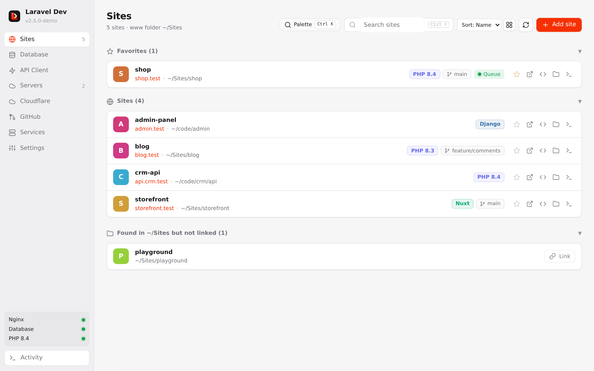</p>

Laravel Dev is a desktop app that runs your projects on your own machine. Each project gets its own
`.test` address, such as `http://shop.test`, served by nginx and PHP-FPM. Around it are the tools of a
working day: logs, a live SQL profiler, a database manager, queues, mail, tests, backups, GitHub,
Cloudflare and deploys to your servers.

| System | Support |
|---|---|
| **Linux** | Full: nginx, `.test` domains, PHP-FPM, services, HTTPS |
| **macOS, Windows** | Portable mode: nothing on your system is changed, and each project runs its own server on a `localhost` port |

It also runs **Next.js, Nuxt, Vite, Node, Django**, WordPress, Symfony and other PHP projects.

---

## Contents

**Start here:** [Install](#installation) · [First 5 minutes](#your-first-5-minutes) · [Adding projects](#adding-your-projects)

**Use it:** [The window](#the-window) · [Site panel](#the-site-panel) · [Profiler](#requests--queries) ·
[Debugging](#step-debugging-with-xdebug) · [Database](#database-manager) · [API client](#api-client) ·
[GitHub](#github) · [Cloudflare](#cloudflare) · [Servers](#remote-servers-ssh) ·
[Services and PHP](#services-and-php-versions) · [AI tools](#ai-tools)

**Reference:** [Settings](#settings) · [Shortcuts](#keyboard-shortcuts) · [Command line](#command-line) ·
[Team file](#team-configuration) · [Files](#where-your-data-is-stored) · [Update](#updating) ·
[Uninstall](#uninstalling) · [Troubleshooting](#troubleshooting)

---

## Installation

### What you need

**Linux**

The Linux installer installs everything below automatically on these systems:

| Family | Package manager | For example |
|---|---|---|
| Debian | `apt` | Ubuntu, Debian, Kali, Linux Mint |
| Arch | `pacman` | Arch, Manjaro, EndeavourOS |
| Red Hat | `dnf` / `yum` | Fedora, RHEL, AlmaLinux, Rocky |
| SUSE | `zypper` | openSUSE |

You need:

- a user account that can use `sudo`;
- an internet connection during installation;
- a desktop session (GNOME, KDE, XFCE and others) to open the app window.

**What gets installed for you:**

| Purpose | Packages |
|---|---|
| Web server | `nginx` |
| Database | `mariadb` (or `mysql` if it's already there) |
| PHP | `php`, `php-cli`, `php-fpm`, `php-mysql`, `php-xml`, `php-mbstring`, `php-curl`, `php-zip` |
| Composer | `composer` |
| Desktop app | `python3`, `python3-gi`, GTK 3, WebKitGTK (`gir1.2-webkit2-4.1` or `4.0`) |
| Database page | `python3-pymysql` (MySQL/MariaDB), `python3-psycopg2` (PostgreSQL), `python3-cryptography` |
| Password prompts | `zenity`, `ssh-askpass` |
| General | `git`, `curl`, `unzip`, `acl`, `openssh-client` |

**Optional.** The installer tries these but continues without them:

| Package | What it adds |
|---|---|
| `mkcert`, `libnss3-tools` | Trusted local HTTPS (`https://shop.test`) |
| `cloudflared` | Public HTTPS links to a local site |
| `nodejs`, `npm` | Next.js, Nuxt, Vite and Node projects, and `npm run dev` for Laravel |
| `python3-venv` | Django projects |
| `gir1.2-ayatanaappindicator3-0.1` (or `libayatana-appindicator`) | The tray icon |
| `phpmyadmin` | phpMyAdmin, if you prefer it to the built-in Database page |

These are installed later, only when you first use the feature:

- `supervisor`, for queue workers;
- `cron` or `cronie`, for the scheduler;
- Mailpit, Redis, Meilisearch and MinIO, from the Services page.

**More PHP versions.** To use several PHP versions side by side (for example 8.2 and 8.4), install
them from your distribution or a PHP repository, such as `ppa:ondrej/php` on Ubuntu. Laravel Dev
detects every installed `phpX.Y-fpm` and lets you pick one per project.

**macOS and Windows**

- **Python 3.10 or newer.** The installer offers to install it with Homebrew (macOS) or winget (Windows).
- **The tools your projects use, available on your `PATH`:** PHP, Composer, and Node, Python and Git as
  needed. Laravel Dev doesn't install them; the **Tools** page shows which ones it found.
- On **Windows**, remote servers need an SSH key or ssh-agent, because password logins over a shared
  SSH connection aren't supported there.

### Install

Download the installer for your system from the project's **Releases** page.

| System | File |
|---|---|
| Linux | `laravel-dev-installer.sh` |
| macOS | `laravel-dev-installer-macos.command` |
| Windows | `laravel-dev-installer-windows.cmd` |

Each installer is a single file that contains the whole app. It checks the app with a SHA-256
checksum before installing. **Run the same installer again later to update.**

#### Linux

Open a terminal in the folder where you downloaded the file:

```bash
chmod +x laravel-dev-installer.sh
./laravel-dev-installer.sh
```

Don't run it with `sudo`; it asks for your password when it needs it. It will:

1. detect your package manager and install the requirements listed above;
2. install Laravel Dev into `/opt/laravel-dev`;
3. add the `laravel-dev` command;
4. add **Laravel Dev** to your applications menu, with its icon;
5. enable and start nginx, MariaDB/MySQL and PHP-FPM.

The installer checks the app itself. If you also download the archive `laravel-dev-tool.tar.gz`, you
can compare its checksum with the value in `laravel-dev-2.5.0.tar.gz.sha256`:

```bash
sha256sum laravel-dev-tool.tar.gz
cat laravel-dev-2.5.0.tar.gz.sha256
```

#### macOS

Open Terminal in the download folder:

```bash
bash laravel-dev-installer-macos.command
```

**Laravel Dev.app** is installed in `~/Applications`, without `sudo`. Launchpad and Spotlight find it.

#### Windows

Double-click `laravel-dev-installer-windows.cmd`. If SmartScreen says "Windows protected your PC",
click **More info → Run anyway**.

Laravel Dev is installed for your user only, in `%LOCALAPPDATA%\Programs\LaravelDev`, without admin
rights. It adds a Start menu shortcut and a desktop shortcut.

---

## Your first 5 minutes

1. **Open the app:** *Laravel Dev* in your applications menu, or `laravel-dev app`.
2. **Check the services.** The bottom left corner shows nginx, the database and PHP. A dot that isn't
   green: open **Services** and press **Start all**.
3. **Choose your www folder** in **Settings** (for example `~/Sites`). Projects already in it show up by
   themselves.
4. **Add a project:** press `Ctrl+N`, type a name, press **Create app**.
5. **Open it:** when the task finishes, `http://<name>.test` works in your browser.

<p align="center">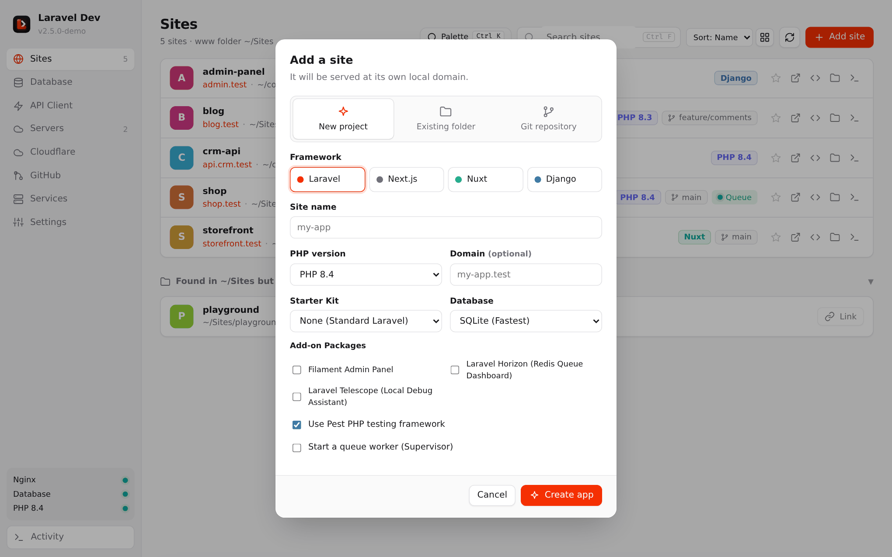</p>

> Changes that need root, such as writing an nginx site, ask for your password in a small dialog.

---

## Adding your projects

Click **Add site** (`Ctrl+N`). There are three ways to add one.

### 1. Create a new project

Choose the type (**Laravel, Next.js, Nuxt or Django**), a name and, for Laravel, a PHP version.
Laravel Dev then:

- creates the project;
- creates a database and writes its details into `.env`;
- sets the folder permissions;
- adds the nginx site.

When the task finishes, open `http://<name>.test`.

### 2. Link an existing folder

Pick a folder. Laravel Dev detects the project type by itself. If the folder is outside your
**www folder**, choose what to do with it:

| Option | What happens |
|---|---|
| **Move** (default) | The folder is moved into the www folder |
| **Copy** | A copy goes into the www folder; the original is left untouched |
| **Shortcut** | A link in the www folder points to the original place |
| **Leave it** | The project is served from where it is |

Projects that are already inside the www folder appear in the list with a **Link** button.

### 3. Clone a Git repository

Paste the repository URL. For a private repository, also paste an access token. Laravel Dev then:

1. clones the repository;
2. runs `composer install`;
3. creates `.env` and the database;
4. links the site.

### Non-Laravel projects

- **Next.js, Nuxt, Vite and Node** projects each get a `.test` domain, which nginx forwards to the
  project's dev server.
- Press **Start** (▶) to run the dev server.
- In the site panel you can switch between development and production commands, edit the command
  (`{port}` is replaced with the project's port), run any npm script and read the server output.
- **Django** uses the project's virtualenv (`.venv`, `venv`, or one in a parent folder) and lets you
  run `manage.py` commands.

---

## The window

| Page | What it's for |
|---|---|
| **Sites** | All your projects, their status and their tools |
| **Database** | A database manager for every project's database |
| **API Client** | Send requests and keep collections, like Postman |
| **Servers** | Your remote servers over SSH |
| **Cloudflare** | Domains, DNS, cache, Workers, R2 and tunnels |
| **GitHub** | Repositories, code, pull requests, issues, Actions |
| **Services** | nginx, the database, PHP-FPM, Redis, Mailpit and more |
| **Settings** | www folder, editor, theme, language, shortcuts, vault, AI |

- **Activity** (`` Ctrl+` ``) at the bottom shows every task with its live output. If something fails, the
  reason is there.
- **Command palette** (`Ctrl+K`) finds projects, pages and artisan commands.
- **Favorites, grid and sorting:** the star keeps a site on top; the grid button switches to cards. On a
  card, the camera takes a preview picture of the site.
- **The tray icon:** closing the window keeps Laravel Dev running. You can turn that off in Settings.

<p align="center">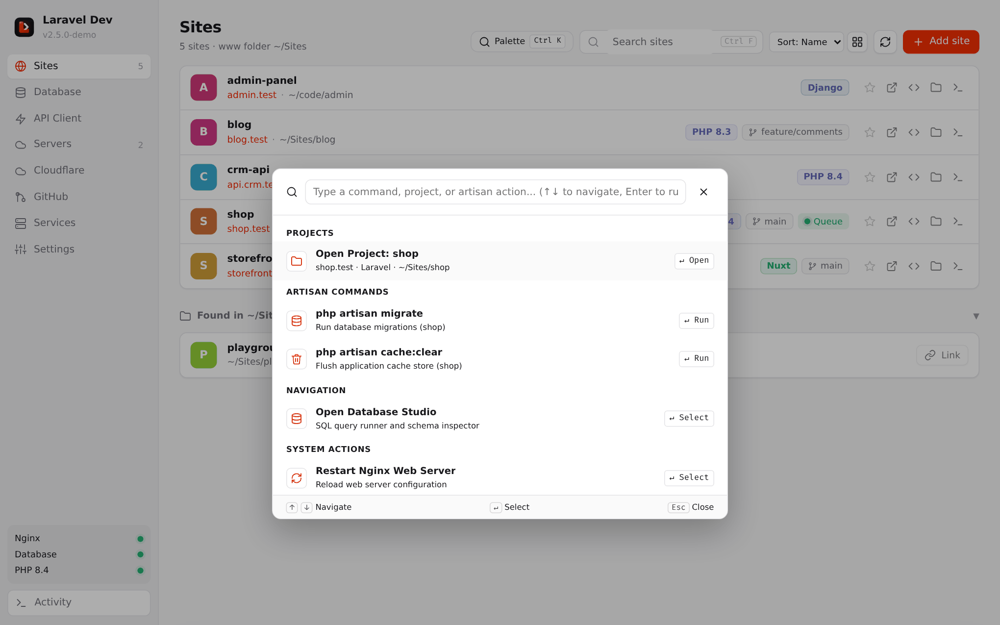</p>

---

## The site panel

Click a site to open it. The buttons on top open the browser, your editor, the folder, a terminal or the
database. Below, the tabs are grouped by what you're doing.

<p align="center">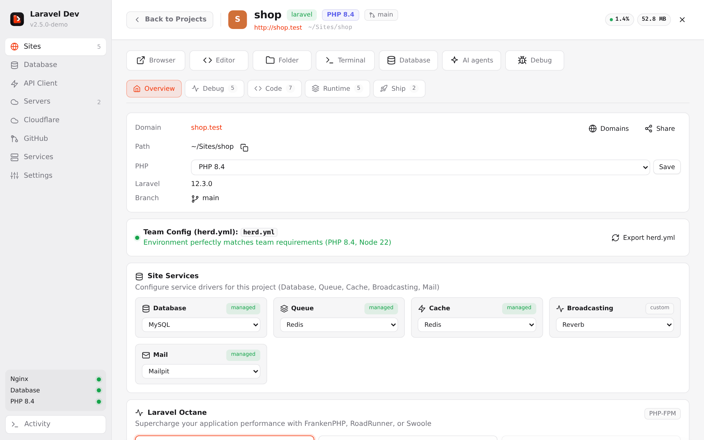</p>

### Overview

- The address, folder, **PHP version** and Git branch. Pick another PHP version and press **Save**.
- **Site services:** switch the database, queue, cache, broadcasting and mail of this project. The `.env`
  is updated for you, and **unmanaged** puts your own values back.
- **Domains:** add extra domains, such as `api.shop.test`.
- **Share:** a link for your Wi-Fi with a QR code, or a public HTTPS link through Cloudflare.
- **HTTPS:** a trusted local certificate through `mkcert`.
- **Doctor** checks permissions, `.env`, `APP_KEY`, migrations and the storage link, and each problem has a
  **Fix** button. **Repair** rebuilds the nginx config, the permissions and the database connection.
- **Workspaces:** open another Git branch as its own site, next to the main one.

### Debug

| Tab | What it does |
|---|---|
| **Requests & Queries** | Every request to the site with its SQL queries. See [the next section](#requests--queries). |
| **Logs** | `storage/logs` as readable entries: level, message and stack trace, with click-to-open file links, filters and live updates. |
| **Dumps** | Catches `dump()` calls from your code and shows them here instead of in the page, with the file and line. |
| **Mail** | Mail the project sends, read from Mailpit or from the `log` mail driver, with HTML preview. |
| **Tests** | Runs Pest or PHPUnit and shows each test's result and time. A failure opens at the exact line in your editor. |

<p align="center">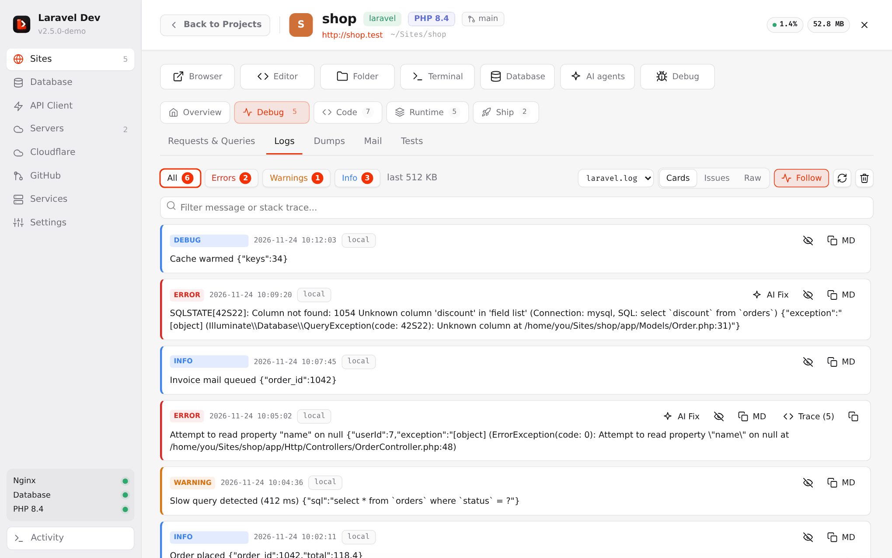</p>

### Code

| Tab | What it does |
|---|---|
| **Studio Agent** | Chat with Claude Code, opencode or another agent about this project. It asks before it edits or runs anything, and its file changes can be reverted. |
| **Models** | Your Eloquent models with their table, columns, relations, casts and fillable fields. |
| **Routes** | All routes, with search and a filter by method. Shows middleware and opens the controller in your editor. |
| **API Client** | The project's routes as ready requests. |
| **Tinker** | Runs PHP in your project with Laravel loaded and shows the result. Keeps a history. |
| **Translations** | Your `lang/` files side by side for every language. JSON translations can be edited here; PHP files open in your editor. |
| **Packages** | Composer and npm packages: outdated versions and known security advisories, with update buttons. |

### Runtime

| Tab | What it does |
|---|---|
| **Environment** | Edits `.env` like Cloudflare or Vercel environment variables. See [details below](#editing-env). |
| **Queues & Cron** | Queue workers, failed jobs (retry or delete) and the scheduler. See [details below](#queues-and-the-scheduler). |
| **Cache & Redis** | Lists cache keys with their TTL and value. Delete one key or clear the whole cache. |
| **Vite & Assets** | Starts and stops the dev server and shows its output. See [below](#vite-starts-by-itself). |
| **Storage Gallery** | Browses the files in `storage/app/public`: preview, search, delete, and fix the `public/storage` link. |

<p align="center">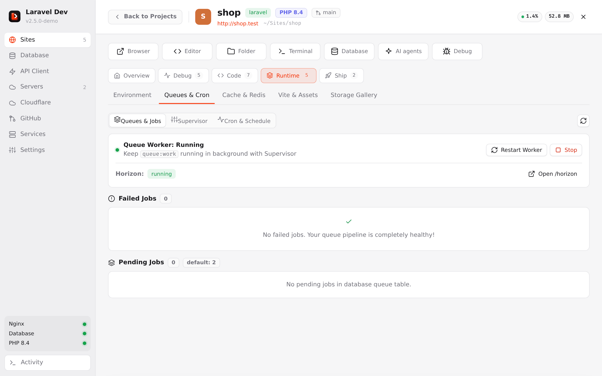</p>

### Ship

| Tab | What it does |
|---|---|
| **Git** | Branch, changed files and diffs. Commit, pull, push, switch or create branches, stash and pop. |
| **Time Machine** | A checkpoint saves `.env`, a database snapshot and `storage/app/public` together. **Restore** brings them back, and saves the current state first so you can undo. |
| **Deploy** | Deploys the project to one of your servers. |

<p align="center">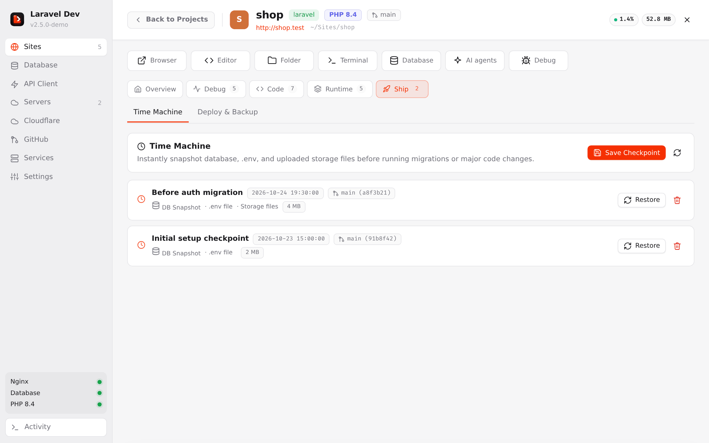</p>
#### Editing .env

- Variables are shown as **Text** or **Secret**. Secrets stay hidden until you click the eye icon.
- You can add, edit and delete variables. **Import .env** takes a pasted file, and one button adds
  what `.env.example` has that `.env` is missing.
- Nothing is written until you press **Save**. The file's comments and order are kept.
- After saving, buttons let you apply the change: clear Laravel's config cache, restart the app, or
  redeploy on a server.
- You can switch between `.env`, `.env.local`, `.env.production` and others, or create a new file.

<p align="center">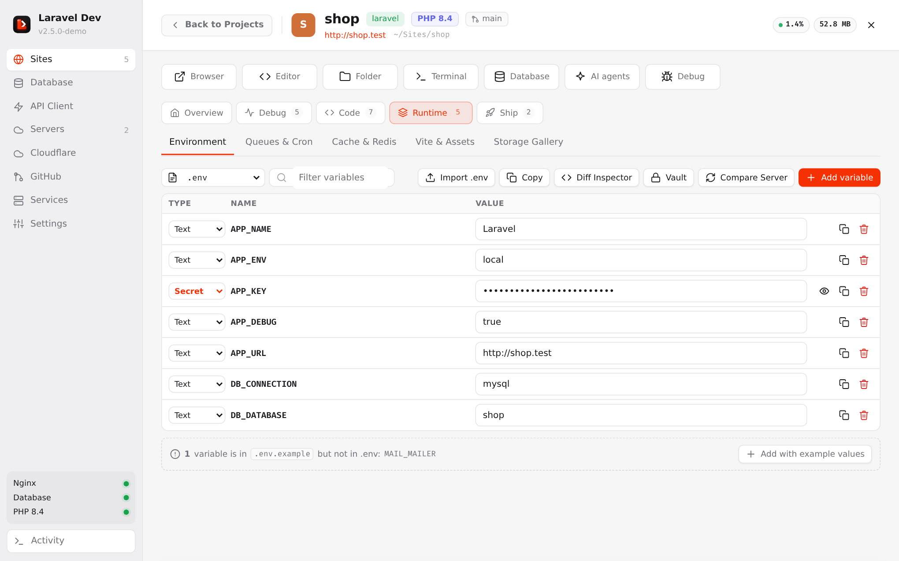</p>

#### Queues and the scheduler

- **Supervisor worker:** runs `queue:work`, or `horizon` when the project uses Laravel Horizon. You
  choose the queues, the number of processes, tries, timeout and sleep. The worker's live output is
  shown here.
- **Scheduler:** one line in your own crontab runs `artisan schedule:run` every minute. Laravel Dev
  never touches your other cron lines. You can also see `schedule:list` and run the scheduler once.
- **Backups:** a backup now, or scheduled daily or weekly backups, with how many to keep. They can be
  uploaded to one of your servers over SSH.

#### Vite starts by itself

In **Runtime → Vite & Assets**, turn on **Start when I open the site**. From then on, opening the site from
Laravel Dev starts its dev server first (`composer run dev` or `npm run dev`) and waits until it's ready. It
stops after 15 minutes without an open page, and when you quit the app. A dev server you started yourself is
used as it is.

<p align="center">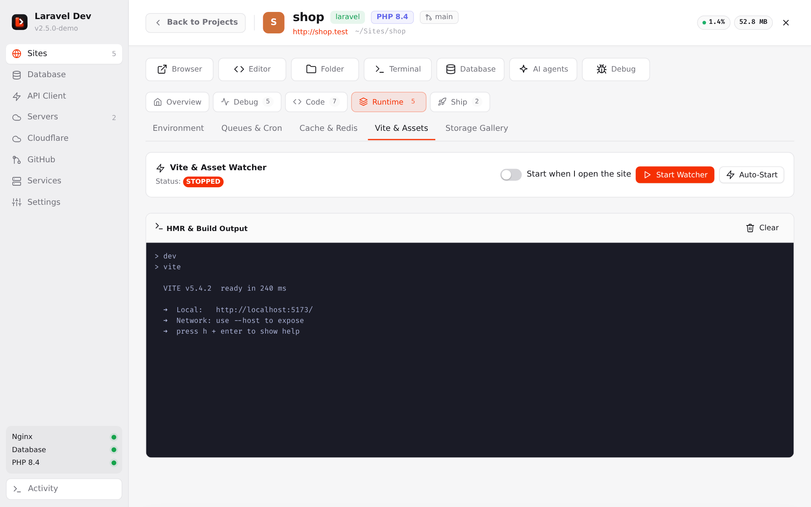</p>

---

## Requests & Queries

This tab shows every request to the site, with the SQL queries each one ran, while you use the site.

<p align="center">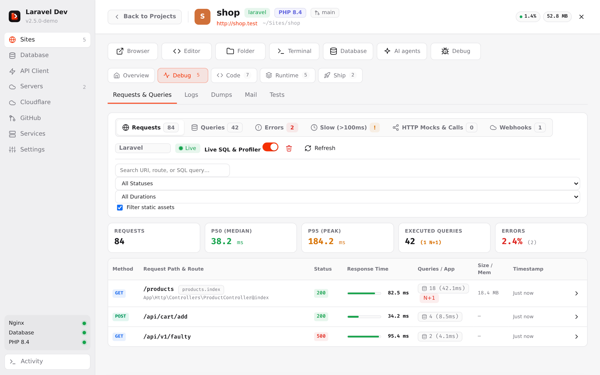</p>

### Turning it on

1. Open the site → **Debug → Requests & Queries**.
2. Turn on **Live SQL & Profiler**. Laravel Dev adds a small development-only package
   (`laravel-dev/profiler`) to the project with Composer. The progress shows in the Activity panel
   and takes 10 to 30 seconds.
3. Open a few pages of your site. The requests appear in the list.

> **Note.** Enabling the profiler changes `composer.json` and `composer.lock` in the project. Don't
> commit those changes. Turn the profiler off before you commit, and the two files go back to what
> they were.

Without the profiler, the tab still shows requests from nginx, but with only the address, status,
size and time.

### Request inspector

Click a request to open it on the side. Use **↑** and **↓** to move to the previous or next request,
and **Esc** to close it.

| Tab | Contents |
|---|---|
| **Headers** | Full URL, method, status and remote address; the route, controller and middleware; response headers and request headers |
| **Payload** | Query string parameters, the request body (form or JSON) and uploaded files |
| **Response** | The response body, formatted and highlighted for JSON. The first 24 KB is kept. |
| **Cookies** | Cookie names and their flags (`HttpOnly`, `Secure`, `SameSite`). Values are never recorded. |
| **Timing** | A waterfall: boot time, each query at the moment it started, your code, and nginx's total time |
| **Queries** | Every SQL query of the request, with its bindings, time and calling file. Copy or `EXPLAIN` any of them. |
| **Context** | Logged-in user, cache hits and misses, rendered views, outgoing HTTP calls, dispatched jobs and memory |
| **cURL** | A ready command to repeat the request from a terminal |

<p align="center">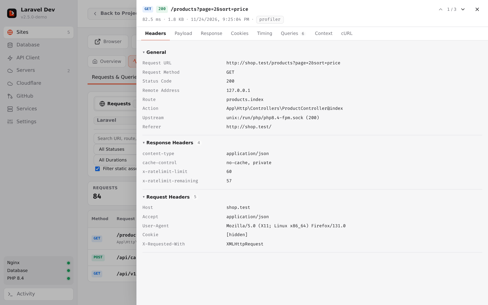</p>

### Query inspector

Below the request list, queries are grouped by their shape. A badge marks the slow ones and the
repeated ones (**N+1**). Click a query to see:

| Tab | Contents |
|---|---|
| **SQL** | The query, formatted; run count, average, fastest, slowest and p95 time; its bindings |
| **Executions** | Every time it ran: when, how long, from which request (click it to open that request) and from which line of code |
| **Callers** | The files and lines that call this query, and how many times each |
| **Explain** | The database's execution plan. The query itself is **not** run. Available for `SELECT` queries only. |

---

## Step debugging with Xdebug

Loading Xdebug makes every request slower, even when you aren't debugging.
**Xdebug on demand** keeps the normal PHP-FPM free of Xdebug and starts a second PHP-FPM that has
it (`laravel-dev-php8.4-fpm-debug` service). nginx sends a request to the debug PHP-FPM only when it
carries an Xdebug trigger:

- the `XDEBUG_SESSION` cookie, which the **Xdebug Helper** browser extension sets when you click
  *Debug*;
- `?XDEBUG_SESSION_START=1` or `?XDEBUG_TRIGGER=1` in the URL.

Your editor must listen on port `9003`. The site panel can add the VS Code `launch.json` for you.
On Debian and Ubuntu, Xdebug is unloaded from the normal PHP-FPM only, so the command line keeps it.
Turning the feature off restores it.

```bash
laravel-dev php-debug-pool 8.4 enable     # or: disable, status
```

**Steps**

1. Install Xdebug for the PHP version if needed: `laravel-dev php-ext 8.4 install xdebug`.
2. On **Services**, press **Xdebug on demand** next to the PHP version. It turns green.
3. Open the site's **Debug** button and add `launch.json` to the project, then start listening in VS Code (F5).
4. Click *Debug* in the **Xdebug Helper** browser extension and reload the page.

<p align="center">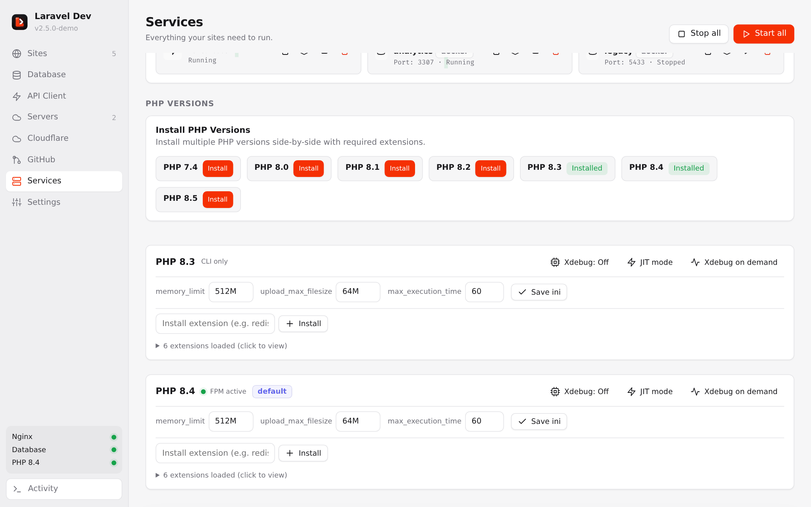</p>

---

## Database manager

The **Database** page is a database manager inside the app, similar to Navicat.

<p align="center">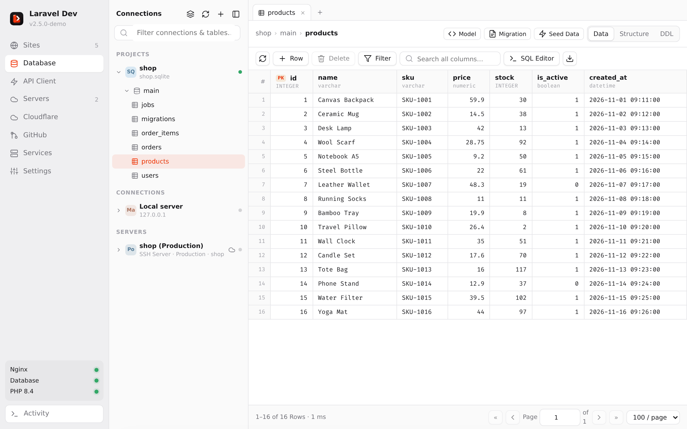</p>

**Supported databases:** MySQL, MariaDB, PostgreSQL and SQLite.

**Connections** on the left come from three places:

- your local database server;
- each project's `.env` (`DB_*` or `DATABASE_URL`, and Django's `db.sqlite3`);
- connections you add yourself.

**Editing tables:**

- Double-click a cell to edit it, add or delete rows, then press **Save** (`Ctrl+S`). All changes are
  saved in one transaction.
- Filter with a `WHERE` clause or search every column. Sort by clicking a column header. Page through
  large tables.
- Right-click a cell to copy its value, copy the row as JSON or as an `INSERT`, filter by the value,
  or set it to `NULL`.

**Structure and SQL:**

- The **Structure** and **DDL** tabs show the table's definition.
- You can rename, empty or drop tables, and create or drop databases.
- Write and run your own SQL in query tabs (`Ctrl+Enter`).

**Import and export:**

- Export a table as SQL, CSV or JSON, or a whole database as SQL.
- Import an `.sql` file.

**On a server:** for a project on one of your servers, the page opens that server's database through
the SSH connection. No port is opened on the server.

---

## API client

A Postman-style client for your own APIs.

- Collections, folders and environments with `{{variables}}`; many requests open in tabs.
- **Sync Laravel Routes** turns a project's routes into ready requests.
- Authentication: Bearer, Basic, API key and Laravel Sanctum (it fetches the CSRF cookie).
- Bodies as JSON, form data with files, or GraphQL. Tests, and values taken from a response for the next request.
- Import Postman collections, OpenAPI and cURL. Export documentation as HTML, Markdown or OpenAPI.

<p align="center">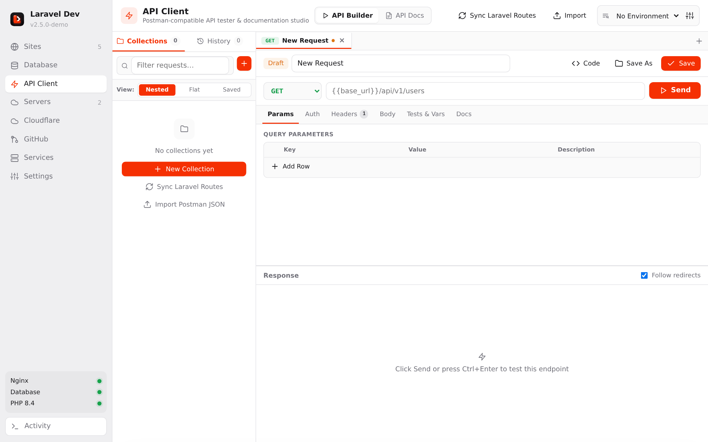</p>

---

## GitHub

Connect with a **Personal Access Token** (Settings → Developer settings on GitHub). Suggested scopes: `repo`,
`workflow`, `read:org`. You can connect several accounts and switch between them.

- **Repositories:** browse code, edit and commit files, read the README, compare branches, releases, settings.
- **Pull requests and issues:** read, comment, review, merge, close.
- **Actions:** runs, jobs, logs, re-run. **CI/CD & VPS** writes a workflow that deploys to one of your servers.
- **Local Sites:** publish a project to a new repository, or link it to an existing one.

Your token is kept in `~/.config/laravel-dev/github.json`, readable only by you. Turn on the
[vault](#settings) to encrypt it.

<p align="center">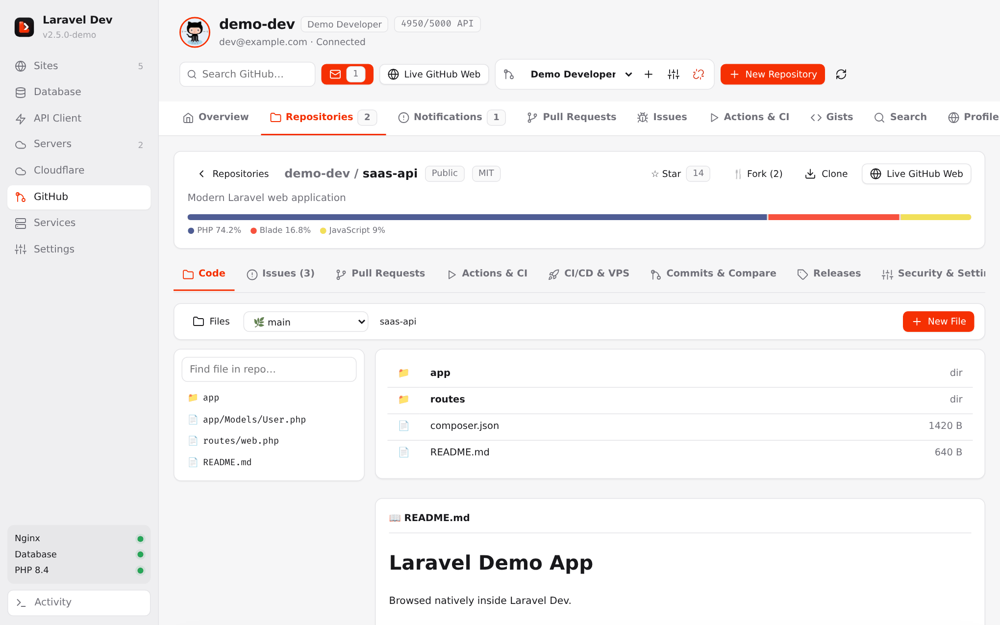</p>

---

## Cloudflare

Connect with an API token to manage your domains: DNS records, SSL, cache purge, firewall rules, Workers &
Pages, R2, KV, D1 and Zero Trust tunnels, with traffic analytics.

<p align="center">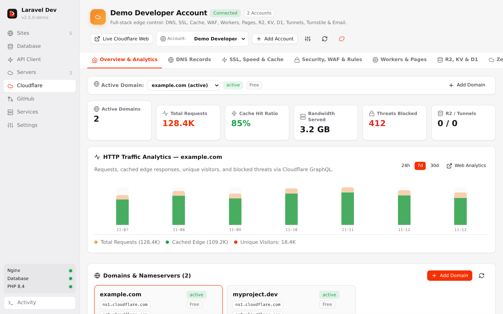</p>

**Share a local site:**

```bash
laravel-dev share shop                         # temporary public HTTPS link
laravel-dev share shop --auth user:secret      # ask for a password
laravel-dev share shop --subdomain shop.example.com --token <tunnel token>
```

---

## Remote servers (SSH)

Open **Servers → Add server**, or pick a host from your `~/.ssh/config`. Nothing is installed on the
server; Laravel Dev uses your normal `ssh` client, keys and ssh-agent.

- **Overview:** CPU, memory, disk and uptime. Start, stop and restart nginx, MySQL/MariaDB, PHP-FPM,
  Redis, Supervisor and other services.
- **Sites:** Laravel, Next.js, Nuxt and Django projects found on the server, each with a **Deploy**
  button that adapts to the type:
  - **Laravel:** `git pull` → `composer install --no-dev` → `migrate --force` → `optimize` → `queue:restart`
  - **Next.js / Nuxt:** `git pull` → `npm ci` (or pnpm, yarn, bun) → `build` → restart with pm2 or systemd
  - **Django:** `git pull` → `pip install -r requirements.txt` → `migrate` → `collectstatic` → restart the service
- Each site also has artisan and `manage.py` commands, maintenance mode, and live logs from
  `laravel.log`, pm2 or journalctl.
- **Files:** browse, upload, download (folders as `.tar.gz`), rename and delete. Clicking a file opens
  it in your local editor, and every save is uploaded back to the server.
- **SSH terminal:** opens your terminal already connected, in the site's folder when you open it from
  a site.

Key-based login is recommended. Password logins are asked once per connection.

<p align="center">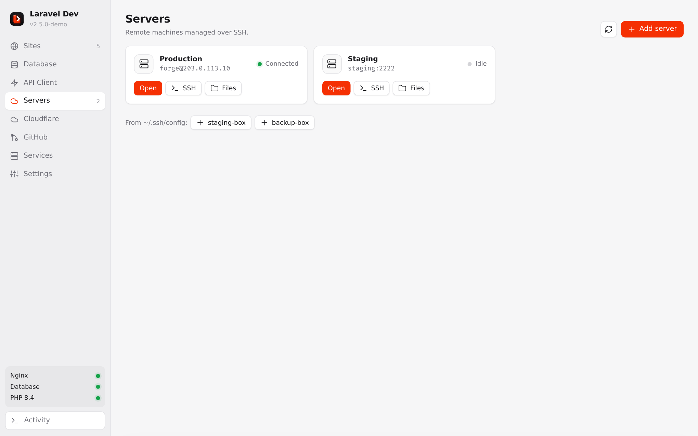</p>
<p align="center">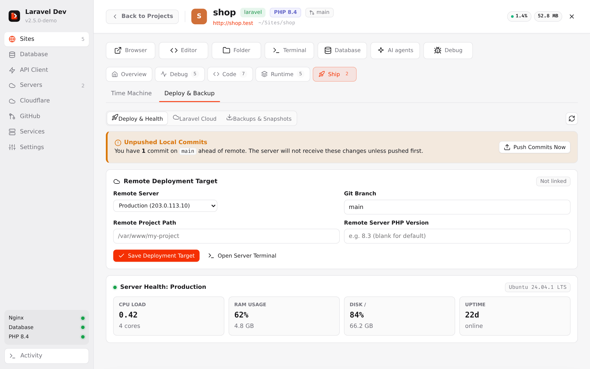</p>

---

## Services and PHP versions

The **Services** page shows each service's status, with start, stop and restart buttons: nginx,
MariaDB/MySQL, every PHP-FPM version, Redis, Supervisor and cron.

<p align="center">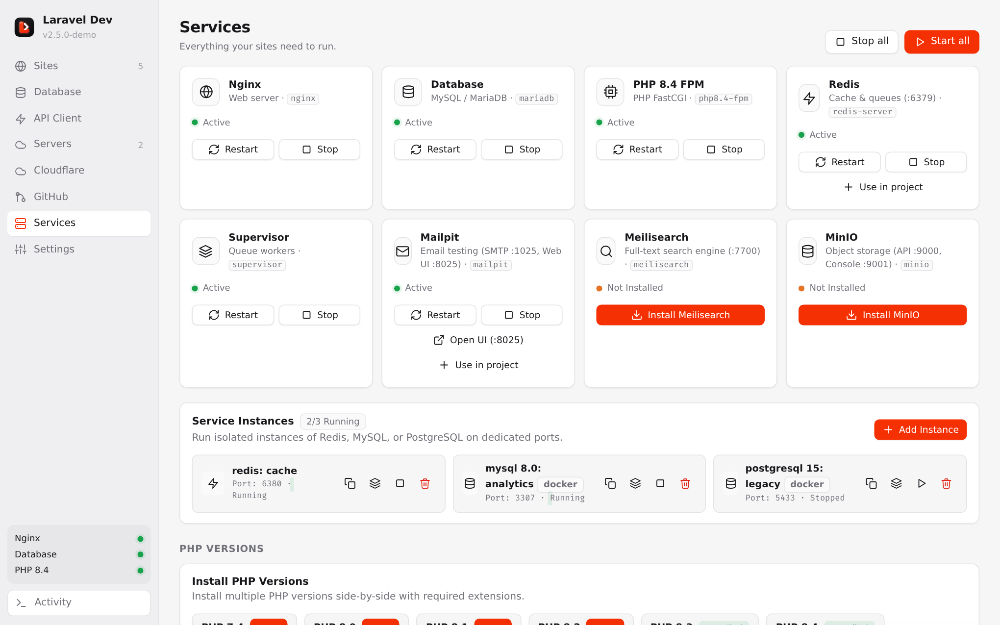</p>

**Extra services**, installed with one click:

| Service | Use | Web page |
|---|---|---|
| **Mailpit** | Catches all outgoing mail locally | `http://127.0.0.1:8025` |
| **Redis** | Cache, queues and sessions | – |
| **Meilisearch** | Search for Laravel Scout | `http://127.0.0.1:7700` |
| **MinIO** | S3-compatible file storage | `http://127.0.0.1:9001` |

After installing one, **Use in project** writes the right settings into a project's `.env`. MinIO
gets a random password, stored in `~/.config/laravel-dev/minio.env`.

**For each installed PHP version** you can:

- turn Xdebug on or off;
- turn on [Xdebug on demand](#step-debugging-with-xdebug);
- change `php.ini` values such as `memory_limit` and `upload_max_filesize`;
- install extensions.

Each project uses its own PHP version, which you can change in the site's Overview.

### Several versions side by side

**Add Instance** runs another MySQL, MariaDB, PostgreSQL or Redis on its own port, with its own data. Choose a
version, such as MySQL 8.0 or PostgreSQL 15. If that version isn't installed, it runs in a container with
**Docker or Podman**: as your user, and reachable from your machine only.

<p align="center">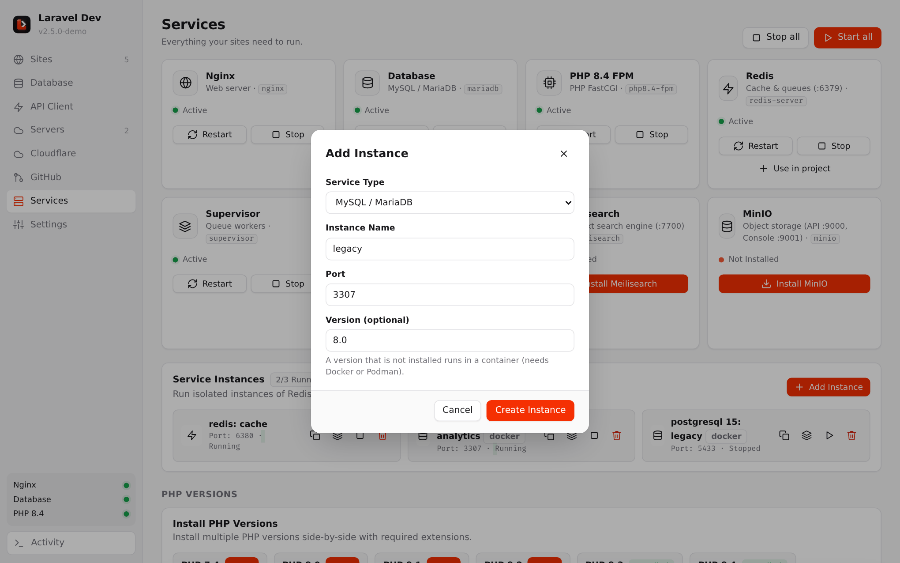</p>

```bash
laravel-dev instance create mysql legacy 3307 8.0
laravel-dev instance create postgresql old 5433 15
laravel-dev instance clone postgresql old copy 5434    # with its data
laravel-dev instance list
laravel-dev instance delete mysql legacy               # removes its data too
```

Versions 10 and 11 of `mysql` are MariaDB. Local instances have no password (`root` for MySQL, `postgres` for
PostgreSQL).

---

## AI tools

- **AI Fix** in Logs and Doctor explains an error and proposes a change as a diff. You decide whether to apply
  it, and a backup is kept. Choose the provider in **Settings → AI Assistant**: Ollama (local), Anthropic,
  OpenAI, Gemini and others. With a cloud provider, the error and the related code are sent to it.
- **Studio Agent** (a site's **Code** tab) runs a coding agent installed on your machine.
- **MCP server:** let Claude Code, Cursor and others read your projects, routes, logs, queries and mails:

  ```bash
  claude mcp add --scope user laravel-dev -- laravel-dev mcp
  ```

  Agents can run read-only SQL and inspection commands. Tools that need root (services, HTTPS, PHP version,
  Xdebug) never show a password prompt; they work only while you have an open session, and otherwise say so.
- **AI agents** on a site adds a section about Laravel Dev to its `AGENTS.md`.

<p align="center">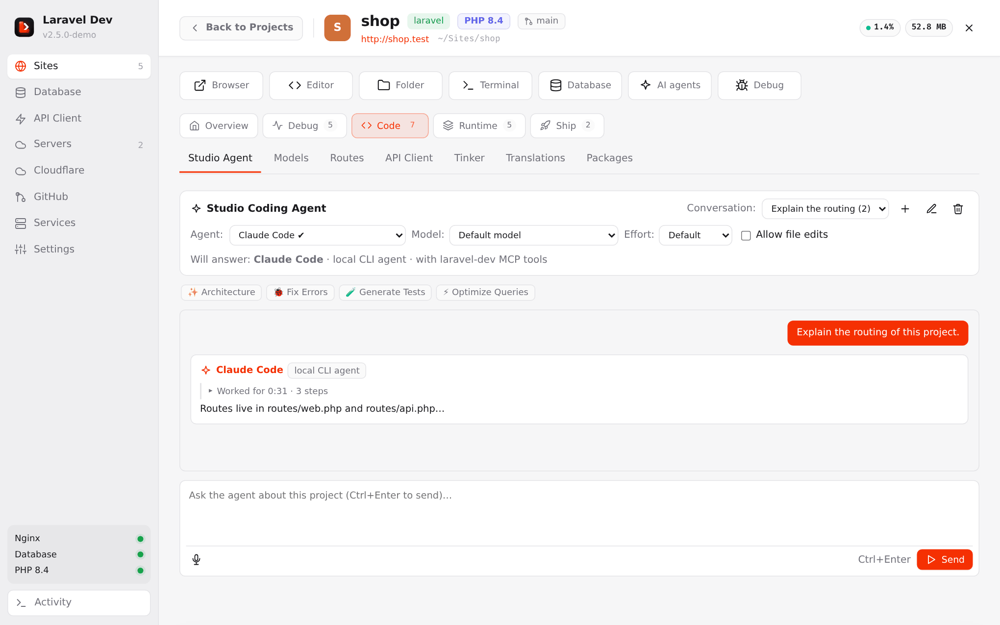</p>

---

## Settings

- **www folder:** where new and moved projects live, for example `~/Sites` or `/var/www`.
- **Default PHP version** for new projects.
- **Editor** used for "open in editor" links, chosen from the editors found on your system.
- **Theme:** light, dark or system.
- **Language:** English or Arabic. Arabic switches the layout to right-to-left.
- **Tray:** keep running in the tray when the window is closed, and launch at login.
- **Updates:** check for a new version.
- **Vault:** an encrypted store for passwords and tokens you use with servers and deploys.
- **System-wide shortcuts:** see the next section.
- **AI Assistant** and **MCP**: see [AI tools](#ai-tools).

<p align="center">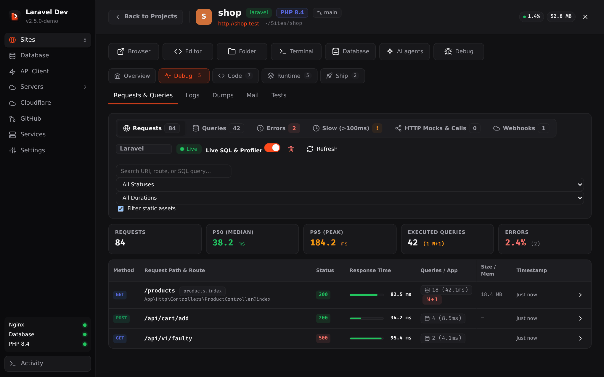 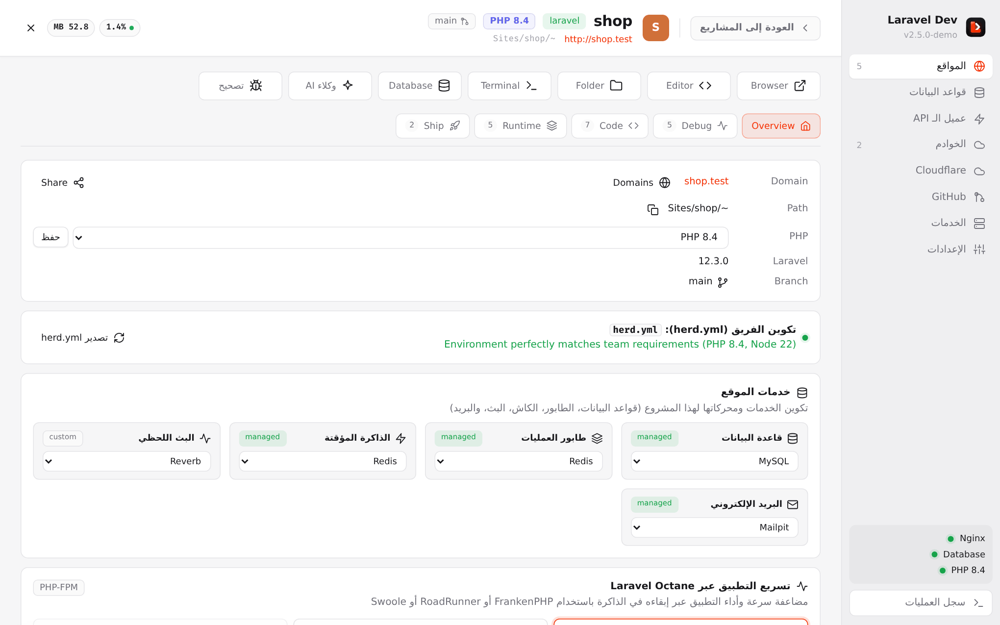</p>

---

## Keyboard shortcuts

| Keys | Action |
|---|---|
| `Ctrl+K` | Command palette: search sites, pages, actions and artisan commands |
| `Ctrl+N` | Add a site |
| `Ctrl+F` | Search sites |
| `Ctrl+R` | Refresh |
| `` Ctrl+` `` | Show or hide the Activity panel |
| `Ctrl+1` … `Ctrl+8` | Sites, Database, API Client, Servers, Cloudflare, GitHub, Services, Settings |
| `Esc` | Close the open dialog, panel or inspector |
| `↑` / `↓` | Previous or next item in the request and query inspectors |

On the Database page:

| Keys | Action |
|---|---|
| `Ctrl+Enter` | Run the query |
| `Ctrl+S` | Save edits |
| `Ctrl+T` / `Ctrl+W` | New tab / close tab |
| `F5` | Reload rows |
| `Delete` | Delete the selected rows |

On macOS, use `Cmd` instead of `Ctrl`.

### From any application

**Settings → System-wide shortcuts → Add shortcuts** (GNOME and Xfce), or `laravel-dev shortcuts install`:

| Keys | Opens |
|---|---|
| `Super+Alt+D` | Laravel Dev |
| `Super+Alt+T` | Tinker |
| `Super+Alt+G` | Logs |
| `Super+Alt+M` | Mail |
| `Super+Alt+B` | Database |
| `Super+Alt+N` | New site |

A key that's already taken is left alone. **Remove** takes away only these. On other desktops,
`laravel-dev shortcuts` lists the commands to add by hand.

<p align="center">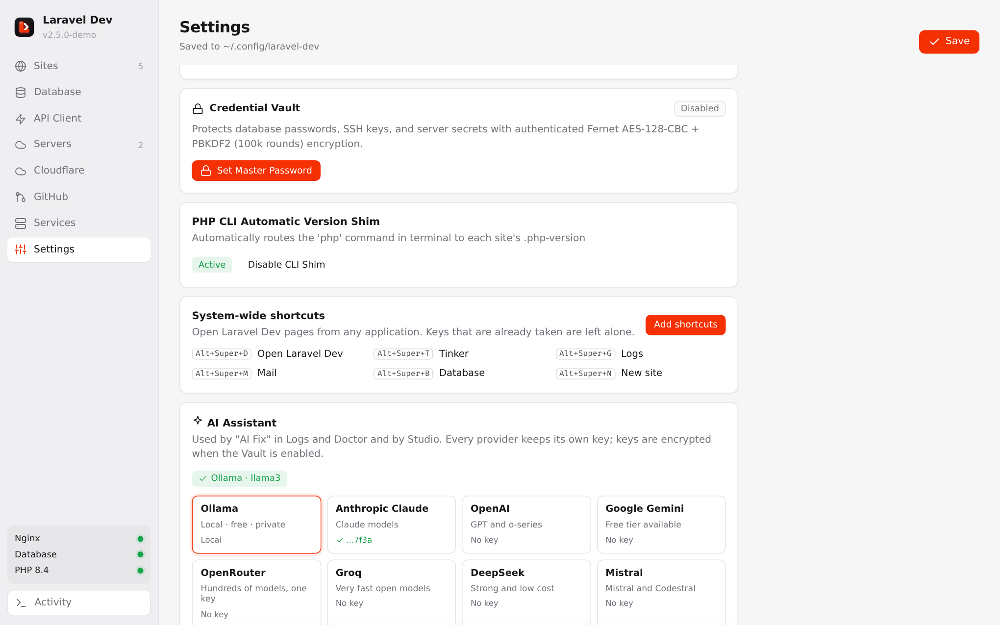</p>

---

## Command line

Everything in the app can also be done from a terminal with `laravel-dev` (Linux).

**Projects**

```bash
laravel-dev create shop 8.4                    # new Laravel project at http://shop.test
laravel-dev link shop ~/code/shop 8.3          # serve an existing folder
laravel-dev git-clone shop https://github.com/me/shop.git 8.4
laravel-dev create-app next web                # new Next.js app (also: nuxt, django)
laravel-dev link-app web ~/code/web next       # existing Next/Nuxt/Vite/Node/Django app
laravel-dev list                               # all projects
laravel-dev repair shop                        # rebuild nginx config, permissions, database
laravel-dev doctor shop                        # health checks
laravel-dev unlink shop                        # stop serving it (files are kept)
laravel-dev delete shop                        # remove the project
```

**HTTPS and sharing**

```bash
laravel-dev secure shop                        # trusted https://shop.test
laravel-dev expose shop lan                    # reachable from your Wi-Fi
laravel-dev expose shop tunnel                 # public HTTPS link through Cloudflare
```

**Queue workers and the scheduler**

```bash
laravel-dev worker-setup shop
laravel-dev worker-config shop queues=high,default processes=3
laravel-dev worker restart shop
laravel-dev worker log shop
laravel-dev cron enable shop
laravel-dev cron status shop
```

**Profiler**

```bash
laravel-dev profiler enable shop
laravel-dev profiler status shop
laravel-dev profiler disable shop
```

**Backups**

```bash
laravel-dev backup-run shop full               # full, db or storage
laravel-dev backup-schedule shop daily 7       # daily, keep 7
laravel-dev backup-prune shop 5
```

**Services and PHP**

```bash
laravel-dev start                              # start nginx, database and PHP-FPM
laravel-dev stop
laravel-dev service restart nginx
laravel-dev service-install redis              # also: mailpit, meilisearch, minio
laravel-dev php-versions
laravel-dev php 8.4 xdebug on
laravel-dev php-debug-pool 8.4 enable          # Xdebug only for requests with a trigger
laravel-dev init --apply                       # use the PHP, Node and services in laravel-dev.yml
laravel-dev php-ini 8.4 memory_limit 512M
laravel-dev php-ext 8.4 install redis
```

**Workspaces** (a Git branch as its own site)

```bash
laravel-dev workspace create shop feature/payments --database=clone   # or: shared, empty
laravel-dev workspace list shop
laravel-dev workspace merge shop feature/payments main --delete
```

**For scripts and agents** (add `--json`; the site defaults to the current folder)

```bash
laravel-dev status
laravel-dev site:info
laravel-dev site:env get APP_URL
laravel-dev db:connection
laravel-dev mail:wait --subject="Reset"
laravel-dev insights:analyze                   # N+1, slow queries, errors
```

**The app**

```bash
laravel-dev app
laravel-dev app --page=logs --site=shop        # open a page directly
laravel-dev shortcuts install
```

Run `laravel-dev` with no arguments to see every command.

---

## Team configuration

Commit a `laravel-dev.yml` so everyone gets the same environment:

```yaml
php: "8.4"
node: "22"
services:
  mysql: true
  redis: true
```

```bash
laravel-dev init            # create the file from the project's .env (and .env from .env.example)
laravel-dev init --apply    # use what an existing file asks for: PHP, Node, services
```

`init` without `--apply` only reports differences. `herd.yml` files are read too.

---

## Where your data is stored

| What | Where |
|---|---|
| The app (Linux) | `/opt/laravel-dev` |
| Settings, project list, saved servers | `~/.config/laravel-dev/` |
| Time Machine checkpoints | `~/.config/laravel-dev/checkpoints/` |
| Service instances and their data | `~/.config/laravel-dev/services/` |
| Site preview pictures | `~/.cache/laravel-dev/previews/` |
| Worker and scheduler logs | `~/.local/log/laravel-dev/` |
| nginx site configs | your distribution's nginx sites folder (`laravel-dev-*` files) |
| Supervisor workers | `/etc/supervisor/conf.d/laravel-dev-<project>.conf` |
| The app (macOS) | `~/Applications/Laravel Dev.app` and `~/Library/Application Support/LaravelDev` |
| The app (Windows) | `%LOCALAPPDATA%\Programs\LaravelDev` and `%APPDATA%\LaravelDev` |

Laravel Dev doesn't send your projects, code or data anywhere. The only outside connections are the
update check, installing packages, the accounts you connect (GitHub, Cloudflare, an AI provider), and the
tools you start yourself (Composer, npm, Git, SSH, tunnels).

---

## Updating

Download the latest installer and run it again. Your settings and projects are kept.

The app also checks for new versions once a day and shows a notice when one is available. You can
check yourself from **Settings → Updates**.

---

## Uninstalling

**Linux**

```bash
sudo /opt/laravel-dev/uninstall.sh
```

This removes the app, its command, its menu entry, its cron lines and its Supervisor workers. Your
project folders and databases are **not** deleted. To stop serving the sites first, run
`laravel-dev unlink <project>` for each one before uninstalling.

**macOS**

```bash
bash ~/Library/Application\ Support/LaravelDev/install/uninstall.command
```

**Windows:** go to **Settings → Apps → Installed apps → Laravel Dev → Uninstall**.

---

## Troubleshooting

**The app window doesn't open.** Install the GUI libraries manually:

```bash
sudo apt install python3-gi gir1.2-gtk-3.0 gir1.2-webkit2-4.1
# if 4.1 isn't available:
sudo apt install python3-gi gir1.2-gtk-3.0 gir1.2-webkit2-4.0
```

On Arch: `sudo pacman -S python-gobject gtk3 webkit2gtk-4.1`.

**`http://name.test` doesn't load.**

1. Check that nginx and PHP-FPM are running on the **Services** page, or run `laravel-dev start`.
2. Run **Repair** on the site, or `laravel-dev repair name`.
3. Make sure your browser isn't using a proxy or a "secure DNS" setting that skips `/etc/hosts`.

**502 Bad Gateway.** The PHP-FPM version the site uses isn't running. Start it on the Services page, or
pick another PHP version for the site.

**Permission errors in `storage` or `bootstrap/cache`.** Open the site's **Doctor** and press **Fix**,
or run **Repair**.

**Turning on the profiler fails.**

- Open the Activity panel to see Composer's real error message.
- Composer must be installed, and the project must install cleanly with `composer install`.
- If the step fails, `composer.json` and `composer.lock` are restored automatically.

**Requests & Queries shows a notice with a Repair button.** Press it once, so the site gets its own
nginx timing log.

**A service instance doesn't start with a version that isn't installed.** Start Docker
(`sudo systemctl start docker`), and add yourself to its group (`sudo usermod -aG docker $USER`, then log in
again), or install Podman.

**GitHub shows an error box.** It names the cause and the token permission that's missing. Press **Retry**
after fixing it.

**No tray icon.** Install `gir1.2-ayatanaappindicator3-0.1` (Debian/Ubuntu) or
`libayatana-appindicator` (Arch), then restart the app. GNOME also needs the
"AppIndicator and KStatusNotifierItem Support" extension.

**Something else.** Every failed action leaves its full output in the **Activity** panel. That output
is the most useful thing to include when you report a problem.

